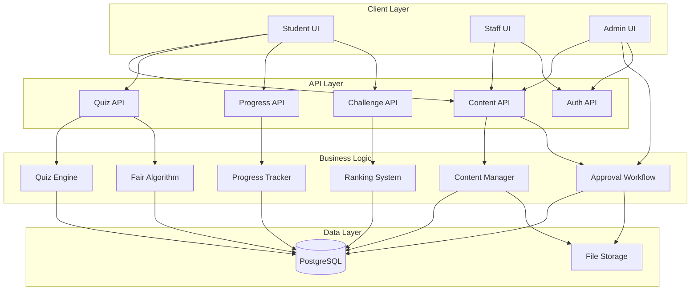

# Design Document: Learning Hub Quiz System

## Overview

The Learning Hub Quiz System is a comprehensive content management and quiz platform for Cambodian driving education. The system supports 8 content categories with bilingual (Khmer/English) content, multimedia support (images and audio), role-based access control (Student, Staff, Admin), and four interactive learning modes (Flashcards, Quiz, Practice Test, Challenge).

### Key Features

- **Content Management System**: Staff create content, admins approve before publication
- **8 Content Categories**: Road Signs, Road Traffic Law, Priority, Driving Skills, Vehicle Technology, Loading People & Goods, General Knowledge, Emergency
- **4 Learning Modes**: Flashcards, Quiz, Practice Test, Challenge
- **Bilingual Support**: All content in Khmer and English with audio playback
- **Quiz Engine**: Fair algorithm for balanced question selection
- **Progress Tracking**: User completion tracking, score history, analytics
- **Ranking System**: Leaderboards for competitive challenges
- **Role-Based Access**: Student (learn), Staff (create), Admin (approve)

### Technology Stack

- **Frontend**: Next.js 14+ with TypeScript, React, Tailwind CSS
- **Backend**: Next.js API Routes (serverless functions)
- **Database**: PostgreSQL with Drizzle ORM
- **File Storage**: Cloudinary or similar for images and audio (all form should be search from Cloudinary resource , or if not found they can use only other resoruce like use url from that resoruce but the primary is shwoing all content type from Cloudinary api )
- **Authentication**: Session-based with role verification

## Architecture

### System Architecture




### Component Architecture


**Frontend Components**:

1. **Student Interface**
   - `CategoryBrowser`: Grid/list view of content items with filtering
   - `ContentDetailModal`: Popup showing full content with images, audio, bilingual text
   - `FlashcardViewer`: Interactive flashcard flip interface
   - `QuizInterface`: Question presentation with answer selection
   - `PracticeTestInterface`: Timed test with progress indicator
   - `ChallengeInterface`: Real-time competitive quiz with rankings
   - `ProgressDashboard`: User statistics and completion tracking
   - `LeaderboardView`: Rankings display by period and category
   - `AudioController`: Bilingual audio playback with mute preferences

2. **Staff Interface**
   - `ContentCreationForm`: Multi-step form for creating content items
   - `MediaUploader`: Image and audio file upload with validation
   - `ContentListView`: View created content with status indicators
   - `ChallengeSessionCreator`: Create and manage challenge sessions

3. **Admin Interface**
   - `ApprovalQueue`: List of pending content for review
   - `ContentReviewModal`: Detailed review with edit and approve/reject actions
   - `AuditLogViewer`: Content history and approval trail
   - `ContentActivationToggle`: Activate/deactivate published content
   - `UserManagement`: Role assignment and user administration

**Backend Services**:

1. **Content Management Service**
   - CRUD operations for content items
   - File upload handling and validation
   - Content status management (pending, active, rejected, inactive)

2. **Approval Workflow Service**
   - Queue management for pending content
   - Approval/rejection with audit trail
   - Notification system for content creators

3. **Quiz Engine Service**
   - Question selection using fair algorithm
   - Answer validation and scoring
   - Session management for quizzes and tests

4. **Progress Tracking Service**
   - User completion tracking per content item
   - Score history and analytics
   - Category completion percentage calculation

5. **Challenge Service**
   - Session creation with room codes
   - Real-time participant management
   - Ranking calculation and leaderboard updates

6. **Audio Service**
   - Audio file storage and retrieval
   - User mute preference management
   - Bilingual audio selection

## Components and Interfaces

### Database Schema


#### Core Tables

**users** (existing, enhanced)
```typescript
{
  id: serial PRIMARY KEY,
  username: text UNIQUE NOT NULL,
  email: text UNIQUE NOT NULL,
  passwordHash: text NOT NULL,
  role: enum('student', 'staff', 'admin') NOT NULL DEFAULT 'student',
  displayName: text,
  avatar: text,
  audioMuted: boolean DEFAULT false, // User audio preference
  isActive: boolean DEFAULT true NOT NULL,
  createdAt: timestamp DEFAULT NOW() NOT NULL,
  updatedAt: timestamp DEFAULT NOW() NOT NULL
}
```

**categories** (existing)
```typescript
{
  id: serial PRIMARY KEY,
  slug: text NOT NULL, // road-sign, road-traffic, priority, etc.
  titleEn: text NOT NULL,
  titleKm: text,
  sortOrder: integer DEFAULT 0,
  isActive: boolean DEFAULT true NOT NULL
}
```

**content_items** (existing, enhanced)
```typescript
{
  id: serial PRIMARY KEY,
  categoryId: integer NOT NULL REFERENCES categories(id),
  type: text NOT NULL, // 'sign', 'question', 'scenario', 'article'
  status: text NOT NULL DEFAULT 'pending', // 'pending', 'active', 'rejected', 'inactive'
  
  // Bilingual content
  titleEn: text NOT NULL,
  titleKm: text NOT NULL DEFAULT '',
  descriptionEn: text NOT NULL DEFAULT '',
  descriptionKm: text NOT NULL DEFAULT '',
  questionEn: text NOT NULL DEFAULT '',
  questionKm: text NOT NULL DEFAULT '',
  answerEn: text NOT NULL DEFAULT '',
  answerKm: text NOT NULL DEFAULT '',
  
  // Media
  imageUrl: text,
  audioUrlEn: text,
  audioUrlKm: text,
  
  // Quiz configuration
  scorePoints: integer DEFAULT 10 NOT NULL,
  timeLimit: integer DEFAULT 30 NOT NULL, // seconds
  difficulty: text, // 'beginner', 'intermediate', 'advanced'
  subtopic: text, // For categorization within category
  
  // Metadata
  sortOrder: integer DEFAULT 0 NOT NULL,
  isActive: boolean DEFAULT false NOT NULL,
  createdBy: integer REFERENCES users(id),
  approvedBy: integer REFERENCES users(id),
  approvedAt: timestamp,
  createdAt: timestamp DEFAULT NOW() NOT NULL,
  updatedAt: timestamp DEFAULT NOW() NOT NULL
}
```


**content_approvals** (new)
```typescript
{
  id: serial PRIMARY KEY,
  contentId: integer NOT NULL REFERENCES content_items(id),
  adminId: integer NOT NULL REFERENCES users(id),
  action: text NOT NULL, // 'approved', 'rejected'
  comments: text,
  createdAt: timestamp DEFAULT NOW() NOT NULL
}
```

**flashcards** (existing)
```typescript
{
  id: serial PRIMARY KEY,
  contentId: integer NOT NULL REFERENCES content_items(id),
  frontEn: text NOT NULL,
  frontKm: text NOT NULL DEFAULT '',
  backEn: text NOT NULL,
  backKm: text NOT NULL DEFAULT '',
  imageUrl: text,
  createdAt: timestamp DEFAULT NOW() NOT NULL
}
```

#### Quiz and Progress Tables

**quizzes** (existing)
```typescript
{
  id: serial PRIMARY KEY,
  title: text NOT NULL,
  titleKm: text NOT NULL DEFAULT '',
  categoryId: integer REFERENCES categories(id),
  level: text NOT NULL DEFAULT 'beginner',
  isPublished: boolean DEFAULT false NOT NULL,
  createdBy: integer REFERENCES users(id),
  createdAt: timestamp DEFAULT NOW() NOT NULL,
  updatedAt: timestamp DEFAULT NOW() NOT NULL
}
```

**quiz_questions** (existing)
```typescript
{
  id: serial PRIMARY KEY,
  quizId: integer NOT NULL REFERENCES quizzes(id),
  contentId: integer NOT NULL REFERENCES content_items(id),
  sortOrder: integer DEFAULT 0 NOT NULL
}
```

**user_progress** (new)
```typescript
{
  id: serial PRIMARY KEY,
  userId: integer NOT NULL REFERENCES users(id),
  contentId: integer NOT NULL REFERENCES content_items(id),
  completed: boolean DEFAULT false NOT NULL,
  lastViewedAt: timestamp,
  createdAt: timestamp DEFAULT NOW() NOT NULL,
  UNIQUE(userId, contentId)
}
```

**quiz_attempts** (new)
```typescript
{
  id: serial PRIMARY KEY,
  userId: integer NOT NULL REFERENCES users(id),
  categoryId: integer REFERENCES categories(id),
  mode: text NOT NULL, // 'quiz', 'practice_test', 'challenge'
  totalQuestions: integer NOT NULL,
  correctAnswers: integer NOT NULL,
  score: integer NOT NULL,
  percentage: integer NOT NULL,
  timeSpent: integer, // seconds
  completedAt: timestamp DEFAULT NOW() NOT NULL
}
```

**quiz_answers** (new)
```typescript
{
  id: serial PRIMARY KEY,
  attemptId: integer NOT NULL REFERENCES quiz_attempts(id),
  contentId: integer NOT NULL REFERENCES content_items(id),
  isCorrect: boolean NOT NULL,
  points: integer NOT NULL,
  timeSpent: integer, // seconds
  answeredAt: timestamp DEFAULT NOW() NOT NULL
}
```


#### Challenge and Ranking Tables

**challenge_sessions** (existing, enhanced)
```typescript
{
  id: serial PRIMARY KEY,
  teacherId: integer NOT NULL REFERENCES users(id),
  categoryId: integer REFERENCES categories(id),
  roomCode: text UNIQUE NOT NULL,
  challengeType: text, // 'timed', 'survival', 'competitive'
  level: text, // 'beginner', 'intermediate', 'advanced'
  maxStudents: integer DEFAULT 40,
  status: text NOT NULL DEFAULT 'waiting', // 'waiting', 'active', 'completed'
  startedAt: timestamp,
  endedAt: timestamp,
  createdAt: timestamp DEFAULT NOW() NOT NULL
}
```

**session_participants** (existing)
```typescript
{
  id: serial PRIMARY KEY,
  sessionId: integer NOT NULL REFERENCES challenge_sessions(id),
  studentId: integer NOT NULL REFERENCES users(id),
  score: integer DEFAULT 0 NOT NULL,
  rank: integer,
  joinedAt: timestamp DEFAULT NOW() NOT NULL,
  UNIQUE(sessionId, studentId)
}
```

**session_answers** (existing)
```typescript
{
  id: serial PRIMARY KEY,
  sessionId: integer NOT NULL REFERENCES challenge_sessions(id),
  studentId: integer NOT NULL REFERENCES users(id),
  contentId: integer NOT NULL REFERENCES content_items(id),
  isCorrect: boolean NOT NULL,
  points: integer DEFAULT 0 NOT NULL,
  timeBonus: integer DEFAULT 0 NOT NULL,
  answeredAt: timestamp DEFAULT NOW() NOT NULL
}
```

**leaderboard_entries** (existing, enhanced)
```typescript
{
  id: serial PRIMARY KEY,
  studentId: integer NOT NULL REFERENCES users(id),
  categoryId: integer REFERENCES categories(id), // NULL for overall
  score: integer DEFAULT 0 NOT NULL,
  correctAnswers: integer DEFAULT 0 NOT NULL,
  totalAttempts: integer DEFAULT 0 NOT NULL,
  rank: integer,
  period: text NOT NULL, // 'weekly', 'monthly', 'all-time'
  periodStart: date NOT NULL,
  updatedAt: timestamp DEFAULT NOW() NOT NULL,
  UNIQUE(studentId, categoryId, period, periodStart)
}
```

#### Audit Tables

**audit_logs** (existing)
```typescript
{
  id: serial PRIMARY KEY,
  userId: integer REFERENCES users(id),
  action: text NOT NULL, // 'content_created', 'content_approved', 'content_rejected', etc.
  entityType: text, // 'content_item', 'user', 'session'
  entityId: integer,
  details: text, // JSON string
  ipAddress: text,
  userAgent: text,
  createdAt: timestamp DEFAULT NOW() NOT NULL
}
```

### API Endpoints


#### Content Management APIs

**GET /api/categories**
- Returns: List of all active categories with titles
- Access: All authenticated users

**GET /api/content/:categorySlug**
- Query params: `?status=active&difficulty=beginner&search=term`
- Returns: Paginated list of content items for category
- Access: Students see only active content, Staff/Admin see all

**GET /api/content/item/:id**
- Returns: Full content item details with media URLs
- Access: All authenticated users (if active or creator/admin)

**POST /api/content/create**
- Body: Content item data with bilingual fields
- Returns: Created content item with status 'pending'
- Access: Staff, Admin
- Side effects: Creates audit log entry

**PUT /api/content/update/:id**
- Body: Updated content item data
- Returns: Updated content item
- Access: Creator (if pending), Admin
- Side effects: Updates updatedAt timestamp, creates audit log

**DELETE /api/content/:id**
- Returns: Success message
- Access: Admin only
- Side effects: Soft delete (sets isActive=false), creates audit log

**POST /api/content/upload**
- Body: FormData with file (image or audio)
- Returns: { url: string, publicId: string }
- Access: Staff, Admin
- Validation: File type, size limits (images 5MB, audio 10MB)

#### Approval Workflow APIs

**GET /api/admin/pending-content**
- Query params: `?categoryId=1&page=1&limit=20`
- Returns: Paginated list of content items with status 'pending'
- Access: Admin only

**POST /api/admin/approve/:contentId**
- Body: { comments?: string }
- Returns: Updated content item with status 'active'
- Access: Admin only
- Side effects: Sets approvedBy, approvedAt, creates content_approvals record, audit log

**POST /api/admin/reject/:contentId**
- Body: { comments: string }
- Returns: Updated content item with status 'rejected'
- Access: Admin only
- Side effects: Creates content_approvals record with rejection reason, audit log

**PUT /api/admin/toggle-active/:contentId**
- Body: { isActive: boolean }
- Returns: Updated content item
- Access: Admin only
- Side effects: Updates isActive flag, creates audit log


#### Quiz Engine APIs

**POST /api/quiz/start**
- Body: { categoryId: number, mode: 'quiz' | 'practice_test', difficulty?: string, questionCount: number }
- Returns: { attemptId: number, questions: ContentItem[] }
- Access: Students
- Logic: Uses Fair Algorithm to select questions

**POST /api/quiz/answer**
- Body: { attemptId: number, contentId: number, answer: string, timeSpent: number }
- Returns: { isCorrect: boolean, points: number, correctAnswer: string }
- Access: Students
- Side effects: Records answer in quiz_answers table

**POST /api/quiz/complete**
- Body: { attemptId: number }
- Returns: { score: number, percentage: number, correctAnswers: number, totalQuestions: number, breakdown: [] }
- Access: Students
- Side effects: Updates quiz_attempts, user_progress, leaderboard_entries

**GET /api/quiz/history**
- Query params: `?userId=1&categoryId=2&limit=10`
- Returns: List of past quiz attempts with scores
- Access: Students (own history), Admin (all)

#### Progress Tracking APIs

**GET /api/progress/:userId**
- Query params: `?categoryId=1`
- Returns: User progress statistics by category
- Access: User (own progress), Admin (all users)

**GET /api/progress/:userId/category/:categoryId**
- Returns: Detailed progress for specific category (completion %, items completed, scores)
- Access: User (own progress), Admin (all users)

**POST /api/progress/mark-viewed**
- Body: { contentId: number }
- Returns: Updated progress record
- Access: Students
- Side effects: Updates user_progress.lastViewedAt

**POST /api/progress/mark-completed**
- Body: { contentId: number }
- Returns: Updated progress record
- Access: Students
- Side effects: Sets user_progress.completed = true


#### Challenge System APIs

**POST /api/challenge/create**
- Body: { categoryId: number, challengeType: string, level: string, maxStudents: number }
- Returns: { sessionId: number, roomCode: string }
- Access: Staff, Admin
- Side effects: Creates challenge_sessions record with unique room code

**POST /api/challenge/join**
- Body: { roomCode: string }
- Returns: { sessionId: number, status: string, participantCount: number }
- Access: Students
- Side effects: Creates session_participants record

**POST /api/challenge/start/:sessionId**
- Returns: { questions: ContentItem[], startedAt: timestamp }
- Access: Session creator (Staff/Admin)
- Side effects: Updates session status to 'active', sets startedAt

**POST /api/challenge/answer**
- Body: { sessionId: number, contentId: number, answer: string, timeSpent: number }
- Returns: { isCorrect: boolean, points: number, timeBonus: number, currentRank: number }
- Access: Session participants
- Side effects: Records answer in session_answers, updates participant score

**POST /api/challenge/complete/:sessionId**
- Returns: { rankings: [], finalScores: [] }
- Access: Session creator
- Side effects: Updates session status to 'completed', sets endedAt, updates leaderboards

**GET /api/challenge/session/:sessionId**
- Returns: Session details with participants and current scores
- Access: Session creator and participants

#### Ranking System APIs

**GET /api/leaderboard**
- Query params: `?categoryId=1&period=weekly&limit=100`
- Returns: Ranked list of students with scores
- Access: All authenticated users

**GET /api/leaderboard/user/:userId**
- Query params: `?categoryId=1&period=weekly`
- Returns: User's rank and score for specified period/category
- Access: All authenticated users

**POST /api/leaderboard/update**
- Body: { userId: number, categoryId: number, score: number, correctAnswers: number }
- Returns: Updated leaderboard entry with new rank
- Access: Internal (called by quiz/challenge completion)
- Side effects: Recalculates ranks for affected period/category


#### User Preference APIs

**GET /api/user/preferences**
- Returns: User preferences including audioMuted
- Access: Authenticated user (own preferences)

**PUT /api/user/preferences**
- Body: { audioMuted: boolean }
- Returns: Updated preferences
- Access: Authenticated user (own preferences)
- Side effects: Updates users.audioMuted

### Data Models

#### TypeScript Interfaces

```typescript
// Content Models
interface Category {
  id: number;
  slug: string;
  titleEn: string;
  titleKm: string;
  sortOrder: number;
  isActive: boolean;
}

interface ContentItem {
  id: number;
  categoryId: number;
  type: 'sign' | 'question' | 'scenario' | 'article';
  status: 'pending' | 'active' | 'rejected' | 'inactive';
  titleEn: string;
  titleKm: string;
  descriptionEn: string;
  descriptionKm: string;
  questionEn: string;
  questionKm: string;
  answerEn: string;
  answerKm: string;
  imageUrl?: string;
  audioUrlEn?: string;
  audioUrlKm?: string;
  scorePoints: number;
  timeLimit: number;
  difficulty?: 'beginner' | 'intermediate' | 'advanced';
  subtopic?: string;
  sortOrder: number;
  isActive: boolean;
  createdBy?: number;
  approvedBy?: number;
  approvedAt?: Date;
  createdAt: Date;
  updatedAt: Date;
}

interface ContentApproval {
  id: number;
  contentId: number;
  adminId: number;
  action: 'approved' | 'rejected';
  comments?: string;
  createdAt: Date;
}

interface Flashcard {
  id: number;
  contentId: number;
  frontEn: string;
  frontKm: string;
  backEn: string;
  backKm: string;
  imageUrl?: string;
  createdAt: Date;
}

// Quiz Models
interface Quiz {
  id: number;
  title: string;
  titleKm: string;
  categoryId?: number;
  level: string;
  isPublished: boolean;
  createdBy?: number;
  createdAt: Date;
  updatedAt: Date;
}

interface QuizAttempt {
  id: number;
  userId: number;
  categoryId?: number;
  mode: 'quiz' | 'practice_test' | 'challenge';
  totalQuestions: number;
  correctAnswers: number;
  score: number;
  percentage: number;
  timeSpent?: number;
  completedAt: Date;
}

interface QuizAnswer {
  id: number;
  attemptId: number;
  contentId: number;
  isCorrect: boolean;
  points: number;
  timeSpent?: number;
  answeredAt: Date;
}

// Progress Models
interface UserProgress {
  id: number;
  userId: number;
  contentId: number;
  completed: boolean;
  lastViewedAt?: Date;
  createdAt: Date;
}

interface ProgressSummary {
  categoryId: number;
  totalItems: number;
  completedItems: number;
  completionPercentage: number;
  averageScore: number;
  lastActivity?: Date;
}

// Challenge Models
interface ChallengeSession {
  id: number;
  teacherId: number;
  categoryId?: number;
  roomCode: string;
  challengeType?: string;
  level?: string;
  maxStudents: number;
  status: 'waiting' | 'active' | 'completed';
  startedAt?: Date;
  endedAt?: Date;
  createdAt: Date;
}

interface SessionParticipant {
  id: number;
  sessionId: number;
  studentId: number;
  score: number;
  rank?: number;
  joinedAt: Date;
}

interface SessionAnswer {
  id: number;
  sessionId: number;
  studentId: number;
  contentId: number;
  isCorrect: boolean;
  points: number;
  timeBonus: number;
  answeredAt: Date;
}

// Ranking Models
interface LeaderboardEntry {
  id: number;
  studentId: number;
  categoryId?: number;
  score: number;
  correctAnswers: number;
  totalAttempts: number;
  rank?: number;
  period: 'weekly' | 'monthly' | 'all-time';
  periodStart: Date;
  updatedAt: Date;
}

interface RankingDisplay {
  rank: number;
  studentId: number;
  displayName: string;
  avatar?: string;
  score: number;
  correctAnswers: number;
  totalAttempts: number;
}
```


### Key Algorithms

#### Fair Question Selection Algorithm

The Fair Algorithm ensures balanced, comprehensive quiz generation:

```typescript
interface FairAlgorithmConfig {
  categoryId: number;
  questionCount: number;
  difficulty?: 'beginner' | 'intermediate' | 'advanced';
  userId: number;
}

async function selectQuestions(config: FairAlgorithmConfig): Promise<ContentItem[]> {
  const { categoryId, questionCount, difficulty, userId } = config;
  
  // 1. Get user's performance history
  const userHistory = await getUserQuizHistory(userId, categoryId);
  const weakTopics = identifyWeakTopics(userHistory);
  const recentQuestions = getRecentlyAnsweredQuestions(userHistory, 50);
  
  // 2. Get available questions
  let availableQuestions = await getActiveQuestions(categoryId);
  
  // Filter by difficulty if specified
  if (difficulty) {
    availableQuestions = availableQuestions.filter(q => q.difficulty === difficulty);
  }
  
  // Exclude recently answered questions
  availableQuestions = availableQuestions.filter(
    q => !recentQuestions.includes(q.id)
  );
  
  // 3. Distribute across subtopics
  const subtopics = groupBySubtopic(availableQuestions);
  const questionsPerSubtopic = Math.ceil(questionCount / subtopics.length);
  
  const selectedQuestions: ContentItem[] = [];
  
  // 4. Prioritize weak topics (40% of questions)
  const weakTopicCount = Math.floor(questionCount * 0.4);
  for (const topic of weakTopics) {
    const topicQuestions = subtopics[topic] || [];
    const selected = randomSample(topicQuestions, Math.min(weakTopicCount / weakTopics.length, topicQuestions.length));
    selectedQuestions.push(...selected);
  }
  
  // 5. Fill remaining with balanced selection
  const remaining = questionCount - selectedQuestions.length;
  const remainingBySubtopic = Math.ceil(remaining / subtopics.length);
  
  for (const [subtopic, questions] of Object.entries(subtopics)) {
    const alreadySelected = selectedQuestions.filter(q => q.subtopic === subtopic).length;
    const needed = Math.max(0, remainingBySubtopic - alreadySelected);
    
    const available = questions.filter(q => !selectedQuestions.includes(q));
    const selected = randomSample(available, Math.min(needed, available.length));
    selectedQuestions.push(...selected);
  }
  
  // 6. Shuffle and return
  return shuffle(selectedQuestions).slice(0, questionCount);
}

function identifyWeakTopics(history: QuizAnswer[]): string[] {
  const topicPerformance = new Map<string, { correct: number; total: number }>();
  
  for (const answer of history) {
    const topic = answer.content.subtopic || 'general';
    const stats = topicPerformance.get(topic) || { correct: 0, total: 0 };
    stats.total++;
    if (answer.isCorrect) stats.correct++;
    topicPerformance.set(topic, stats);
  }
  
  return Array.from(topicPerformance.entries())
    .filter(([_, stats]) => stats.total >= 3 && stats.correct / stats.total < 0.6)
    .map(([topic]) => topic)
    .slice(0, 3); // Top 3 weak topics
}
```

#### Ranking Calculation Algorithm

```typescript
interface RankingUpdate {
  userId: number;
  categoryId?: number;
  scoreChange: number;
  correctAnswersChange: number;
  period: 'weekly' | 'monthly' | 'all-time';
}

async function updateRankings(update: RankingUpdate): Promise<void> {
  const { userId, categoryId, scoreChange, correctAnswersChange, period } = update;
  const periodStart = getPeriodStart(period);
  
  // 1. Update or create leaderboard entry
  const entry = await db.leaderboardEntries.findOne({
    where: { userId, categoryId, period, periodStart }
  });
  
  if (entry) {
    await db.leaderboardEntries.update(entry.id, {
      score: entry.score + scoreChange,
      correctAnswers: entry.correctAnswers + correctAnswersChange,
      totalAttempts: entry.totalAttempts + 1,
      updatedAt: new Date()
    });
  } else {
    await db.leaderboardEntries.create({
      userId,
      categoryId,
      score: scoreChange,
      correctAnswers: correctAnswersChange,
      totalAttempts: 1,
      period,
      periodStart
    });
  }
  
  // 2. Recalculate ranks for affected leaderboard
  const allEntries = await db.leaderboardEntries.findMany({
    where: { categoryId, period, periodStart },
    orderBy: [
      { score: 'desc' },
      { correctAnswers: 'desc' },
      { updatedAt: 'asc' }
    ]
  });
  
  // 3. Update ranks
  for (let i = 0; i < allEntries.length; i++) {
    await db.leaderboardEntries.update(allEntries[i].id, {
      rank: i + 1
    });
  }
}

function getPeriodStart(period: string): Date {
  const now = new Date();
  
  if (period === 'weekly') {
    const day = now.getDay();
    const diff = now.getDate() - day;
    return new Date(now.setDate(diff));
  }
  
  if (period === 'monthly') {
    return new Date(now.getFullYear(), now.getMonth(), 1);
  }
  
  // all-time uses epoch
  return new Date(0);
}
```


#### Scoring Algorithm

```typescript
interface ScoringConfig {
  basePoints: number;
  timeLimit: number;
  timeSpent: number;
  mode: 'quiz' | 'practice_test' | 'challenge';
}

function calculateScore(config: ScoringConfig, isCorrect: boolean): number {
  if (!isCorrect) return 0;
  
  const { basePoints, timeLimit, timeSpent, mode } = config;
  let score = basePoints;
  
  // Apply time bonus for challenge mode
  if (mode === 'challenge' && timeSpent < timeLimit) {
    const timeRatio = 1 - (timeSpent / timeLimit);
    const timeBonus = Math.floor(basePoints * timeRatio * 0.5); // Up to 50% bonus
    score += timeBonus;
  }
  
  return score;
}
```

### Implementation Approach

#### Phase 1: Database Schema and Core APIs

1. **Update Database Schema**
   - Add `status` field to `content_items` table
   - Add `audioMuted` field to `users` table
   - Create `content_approvals` table
   - Create `user_progress` table
   - Create `quiz_attempts` and `quiz_answers` tables
   - Update `leaderboard_entries` with category and period fields

2. **Implement Content Management APIs**
   - CRUD endpoints for content items
   - File upload handling with Cloudinary
   - Content filtering and search

3. **Implement Approval Workflow APIs**
   - Pending content queue
   - Approve/reject endpoints with audit trail
   - Content activation toggle

#### Phase 2: Quiz Engine and Progress Tracking

1. **Implement Fair Algorithm**
   - Question selection logic
   - User history analysis
   - Weak topic identification

2. **Implement Quiz APIs**
   - Quiz start with question generation
   - Answer submission and validation
   - Quiz completion with scoring

3. **Implement Progress Tracking**
   - Progress recording endpoints
   - Statistics calculation
   - Category completion tracking

#### Phase 3: Challenge System and Rankings

1. **Implement Challenge APIs**
   - Session creation with room codes
   - Participant management
   - Real-time answer submission
   - Session completion and ranking

2. **Implement Ranking System**
   - Leaderboard calculation
   - Rank updates after quiz/challenge
   - Period-based rankings (weekly, monthly, all-time)

#### Phase 4: Frontend Components

1. **Student Interface**
   - Category browser with filtering
   - Content detail modal
   - Flashcard viewer
   - Quiz interface
   - Practice test interface
   - Challenge interface
   - Progress dashboard
   - Leaderboard view

2. **Staff Interface**
   - Content creation form
   - Media uploader
   - Content list with status

3. **Admin Interface**
   - Approval queue
   - Content review modal
   - Audit log viewer
   - User management


## Correctness Properties

*A property is a characteristic or behavior that should hold true across all valid executions of a system—essentially, a formal statement about what the system should do. Properties serve as the bridge between human-readable specifications and machine-verifiable correctness guarantees.*

### Property Reflection

After analyzing all acceptance criteria, I identified several areas of redundancy:

- Properties 19.4 and 19.5 both test audio mute behavior - can be combined into one comprehensive property
- Properties 10.1 and 10.5 both test staff content creation restrictions - can be combined
- Properties 23.4 and 23.5 overlap with 10.5 and 23.2 on permission enforcement
- Properties 29.1, 29.2, 29.3 all test audit field population - can be combined into one property
- Multiple properties test bilingual field presence (1.3, 10.3) - can be generalized

The following properties represent the unique, non-redundant validation requirements:

### Property 1: Category Configuration

*For any* query to the categories table, the system should return exactly 8 categories with slugs: road-sign, road-traffic, priority, driving, technical, loading-people-goods, general-knowledge, emergency.

**Validates: Requirements 1.1**

### Property 2: Bilingual Content Completeness

*For any* content item or category, both the English and Khmer language fields (titleEn, titleKm, descriptionEn, descriptionKm, etc.) should be non-null and non-empty when the content is active.

**Validates: Requirements 1.3, 10.3**

### Property 3: Staff Content Creation Status

*For any* content item created by a user with role='staff', the status field should be set to 'pending' and the user should not be able to directly set status='active'.

**Validates: Requirements 10.1, 10.5, 23.5**

### Property 4: Content Creator Attribution

*For any* content item creation, the createdBy field should equal the creating user's ID, and createdAt and updatedAt timestamps should be set automatically.

**Validates: Requirements 10.4, 29.1, 29.2, 29.3**

### Property 5: Approval Workflow State Transitions

*For any* content item with status='pending', when an admin performs an approval action, the status should transition to 'active' (if approved) or 'rejected' (if rejected), and a content_approvals record should be created with the admin's ID and timestamp.

**Validates: Requirements 11.2, 11.3, 11.5**

### Property 6: Pending Content Visibility

*For any* query for pending content by an admin user, all content items with status='pending' should be returned, and admins should be able to edit any field before approval.

**Validates: Requirements 11.1, 11.4**

### Property 7: Quiz Question Selection Invokes Fair Algorithm

*For any* quiz start request (quiz, practice test, or challenge mode), the Fair Algorithm should be invoked to select questions, and the selected questions should be returned.

**Validates: Requirements 13.1**

### Property 8: Quiz Completion Recording

*For any* completed quiz, a quiz_attempts record should be created with userId, categoryId, mode, totalQuestions, correctAnswers, score, percentage, and completedAt timestamp.

**Validates: Requirements 13.5**

### Property 9: Fair Algorithm Subtopic Distribution

*For any* question selection by the Fair Algorithm, questions should be distributed across all available subtopics within the category proportionally.

**Validates: Requirements 16.1**

### Property 10: Fair Algorithm Recency Exclusion

*For any* quiz session, the Fair Algorithm should exclude questions that the user has answered in their last N attempts (where N is configurable, default 50).

**Validates: Requirements 16.3**

### Property 11: Fair Algorithm Weak Topic Prioritization

*For any* user with identified weak topics (topics where correct answer rate < 60% over at least 3 attempts), the Fair Algorithm should allocate approximately 40% of questions to those weak topics.

**Validates: Requirements 16.4**

### Property 12: Fair Algorithm Difficulty Adaptation

*For any* user, the Fair Algorithm should select question difficulty levels based on the user's performance history, with higher-performing users receiving more advanced questions.

**Validates: Requirements 16.2**

### Property 13: Progress Tracking Per Content Item

*For any* user and content item combination, a user_progress record should exist or be created when the user views or completes the content, with completed flag and lastViewedAt timestamp.

**Validates: Requirements 18.1**

### Property 14: Category Completion Percentage Calculation

*For any* user and category, the completion percentage should equal (number of completed content items / total active content items in category) × 100.

**Validates: Requirements 18.2**

### Property 15: Audio Mute Preference Enforcement

*For any* user with audioMuted=true in their profile, audio should not auto-play on any content, but manual playback via play buttons should still function.

**Validates: Requirements 19.4, 19.5, 20.5**

### Property 16: Audio Mute Preference Persistence

*For any* user, setting audioMuted in preferences should persist to the database, and retrieving preferences should return the same audioMuted value (round-trip property).

**Validates: Requirements 20.4**

### Property 17: Role-Based Content Access

*For any* user with role='student', they should be able to browse active content and take quizzes, but should not be able to access content creation routes or admin approval interfaces.

**Validates: Requirements 23.1, 23.4**

### Property 18: Role-Based Content Creation

*For any* user with role='staff', they should be able to create and edit their own pending content, but cannot approve content or access admin-only features.

**Validates: Requirements 23.2**

### Property 19: Role-Based Admin Permissions

*For any* user with role='admin', they should have access to all features including content approval, user management, and all content regardless of status.

**Validates: Requirements 23.3**

### Property 20: File Upload Format Validation

*For any* file upload, the system should accept only specified formats (JPG, PNG, SVG, WebP for images; MP3, WAV, OGG for audio) and reject other formats with an error message.

**Validates: Requirements 25.1, 25.2**

### Property 21: File Upload Size Validation

*For any* file upload, the system should enforce size limits (images ≤ 5MB, audio ≤ 10MB) and reject files exceeding these limits with an error message.

**Validates: Requirements 25.3**

### Property 22: Quiz Scoring Based on Content Configuration

*For any* correct answer in a quiz, the points awarded should equal the content item's scorePoints value, and in challenge mode, a time bonus should be added based on response speed.

**Validates: Requirements 26.1, 26.2**

### Property 23: Quiz Total Score Calculation

*For any* completed quiz, the total score should equal the sum of points from all individual question answers.

**Validates: Requirements 26.3**

### Property 24: Challenge Session Room Code Uniqueness

*For any* challenge session creation, the generated roomCode should be unique across all active sessions (sessions with status='waiting' or 'active').

**Validates: Requirements 28.1**

### Property 25: Challenge Session Participant Limit

*For any* challenge session, the number of participants should not exceed the session's maxStudents value, and join attempts beyond this limit should be rejected.

**Validates: Requirements 28.2**

### Property 26: Inactive Content Exclusion for Students

*For any* content item with isActive=false, it should not appear in student browse interfaces, quiz question selection, or any student-facing features, but should remain visible to staff and admin users.

**Validates: Requirements 30.2, 30.5**


## Error Handling

### API Error Responses

All API endpoints should return consistent error responses:

```typescript
interface ErrorResponse {
  error: string;
  message: string;
  statusCode: number;
  details?: any;
}
```

### Error Categories

**Authentication Errors (401)**
- Missing or invalid session token
- Expired session
- User account suspended or inactive

**Authorization Errors (403)**
- Insufficient permissions for requested action
- Role-based access denied
- Attempting to access another user's private data

**Validation Errors (400)**
- Missing required fields
- Invalid field formats or values
- File upload validation failures (size, format)
- Business rule violations (e.g., staff trying to publish directly)

**Not Found Errors (404)**
- Content item not found
- Category not found
- User not found
- Session not found

**Conflict Errors (409)**
- Duplicate room code generation
- Concurrent modification conflicts
- Session already started/completed

**Server Errors (500)**
- Database connection failures
- File storage service errors
- Unexpected exceptions

### Error Handling Strategies

**Database Errors**
- Wrap all database operations in try-catch blocks
- Log errors with context (user ID, operation, timestamp)
- Return user-friendly error messages
- Implement retry logic for transient failures

**File Upload Errors**
- Validate file type and size before upload
- Handle storage service failures gracefully
- Clean up partial uploads on failure
- Provide clear error messages for validation failures

**Quiz Engine Errors**
- Handle insufficient questions gracefully (adjust quiz length or notify user)
- Validate answer submissions (correct format, within time limit)
- Handle concurrent answer submissions in challenges
- Recover from partial quiz state

**Progress Tracking Errors**
- Handle missing progress records (create on first access)
- Validate progress updates (user owns the progress record)
- Handle concurrent progress updates (last write wins)

**Ranking System Errors**
- Handle missing leaderboard entries (create on first score)
- Validate ranking calculations (no negative scores/ranks)
- Handle concurrent ranking updates (use transactions)
- Recover from incomplete ranking recalculations


## Testing Strategy

### Dual Testing Approach

The system requires both unit tests and property-based tests for comprehensive coverage:

- **Unit tests**: Verify specific examples, edge cases, error conditions, and integration points
- **Property tests**: Verify universal properties across all inputs through randomization

Unit tests should focus on concrete scenarios while property tests ensure correctness across the input space. Together they provide comprehensive validation.

### Property-Based Testing

**Library Selection**: Use `fast-check` for TypeScript/JavaScript property-based testing

**Configuration**: Each property test should run minimum 100 iterations to ensure adequate randomization coverage

**Test Tagging**: Each property test must reference its design document property using the format:
```typescript
// Feature: learning-hub-quiz-system, Property 1: Category Configuration
```

**Property Test Implementation**:

```typescript
import fc from 'fast-check';

// Feature: learning-hub-quiz-system, Property 2: Bilingual Content Completeness
test('all active content has complete bilingual fields', () => {
  fc.assert(
    fc.property(
      fc.record({
        titleEn: fc.string({ minLength: 1 }),
        titleKm: fc.string({ minLength: 1 }),
        descriptionEn: fc.string({ minLength: 1 }),
        descriptionKm: fc.string({ minLength: 1 }),
        isActive: fc.constant(true)
      }),
      (content) => {
        // All bilingual fields should be non-empty for active content
        expect(content.titleEn).toBeTruthy();
        expect(content.titleKm).toBeTruthy();
        expect(content.descriptionEn).toBeTruthy();
        expect(content.descriptionKm).toBeTruthy();
      }
    ),
    { numRuns: 100 }
  );
});

// Feature: learning-hub-quiz-system, Property 3: Staff Content Creation Status
test('staff-created content always has pending status', () => {
  fc.assert(
    fc.property(
      fc.record({
        createdBy: fc.integer({ min: 1 }),
        creatorRole: fc.constant('staff'),
        title: fc.string({ minLength: 1 })
      }),
      async (input) => {
        const content = await createContent(input.createdBy, input.title);
        expect(content.status).toBe('pending');
        
        // Staff should not be able to set status to active
        await expect(
          updateContent(content.id, { status: 'active' }, input.createdBy)
        ).rejects.toThrow();
      }
    ),
    { numRuns: 100 }
  );
});

// Feature: learning-hub-quiz-system, Property 14: Category Completion Percentage Calculation
test('completion percentage equals completed/total * 100', () => {
  fc.assert(
    fc.property(
      fc.record({
        totalItems: fc.integer({ min: 1, max: 100 }),
        completedItems: fc.integer({ min: 0, max: 100 })
      }).filter(({ totalItems, completedItems }) => completedItems <= totalItems),
      ({ totalItems, completedItems }) => {
        const expected = Math.floor((completedItems / totalItems) * 100);
        const actual = calculateCompletionPercentage(completedItems, totalItems);
        expect(actual).toBe(expected);
      }
    ),
    { numRuns: 100 }
  );
});

// Feature: learning-hub-quiz-system, Property 16: Audio Mute Preference Persistence
test('audio mute preference round-trip', () => {
  fc.assert(
    fc.property(
      fc.record({
        userId: fc.integer({ min: 1 }),
        audioMuted: fc.boolean()
      }),
      async ({ userId, audioMuted }) => {
        // Set preference
        await updateUserPreferences(userId, { audioMuted });
        
        // Retrieve preference
        const preferences = await getUserPreferences(userId);
        
        // Should match what was set
        expect(preferences.audioMuted).toBe(audioMuted);
      }
    ),
    { numRuns: 100 }
  );
});

// Feature: learning-hub-quiz-system, Property 23: Quiz Total Score Calculation
test('total score equals sum of question scores', () => {
  fc.assert(
    fc.property(
      fc.array(
        fc.record({
          isCorrect: fc.boolean(),
          points: fc.integer({ min: 0, max: 100 })
        }),
        { minLength: 1, maxLength: 50 }
      ),
      (answers) => {
        const expectedTotal = answers.reduce((sum, a) => sum + (a.isCorrect ? a.points : 0), 0);
        const actualTotal = calculateQuizScore(answers);
        expect(actualTotal).toBe(expectedTotal);
      }
    ),
    { numRuns: 100 }
  );
});
```

### Unit Testing

**Test Coverage Areas**:

1. **Content Management**
   - Create content with all required fields
   - Update content with validation
   - Delete content (soft delete)
   - File upload with valid/invalid formats
   - File upload with size limits
   - Content filtering by category, status, difficulty

2. **Approval Workflow**
   - Approve pending content (status change, audit log)
   - Reject pending content (status change, audit log, comments)
   - Admin edit during review
   - Non-admin cannot approve

3. **Quiz Engine**
   - Start quiz with Fair Algorithm
   - Submit correct answer (points awarded)
   - Submit incorrect answer (no points)
   - Complete quiz (score calculation, progress recording)
   - Practice test with time limits
   - Challenge mode with time bonuses

4. **Fair Algorithm**
   - Question selection with subtopic distribution
   - Exclude recent questions
   - Prioritize weak topics
   - Adapt difficulty to user level
   - Handle insufficient questions

5. **Progress Tracking**
   - Mark content as viewed
   - Mark content as completed
   - Calculate category completion percentage
   - Track quiz scores over time

6. **Challenge System**
   - Create session with unique room code
   - Join session (within participant limit)
   - Start session (status change)
   - Submit answers (scoring with time bonus)
   - Complete session (rankings calculation)

7. **Ranking System**
   - Update leaderboard after quiz
   - Calculate ranks (order by score, then correct answers)
   - Period-based rankings (weekly, monthly, all-time)
   - Category-specific and overall rankings

8. **Role-Based Access Control**
   - Student can browse and take quizzes
   - Student cannot create content
   - Staff can create content (pending status)
   - Staff cannot approve content
   - Admin can approve content
   - Admin can access all features

9. **Audio Controller**
   - Respect mute preference (no auto-play)
   - Allow manual playback when muted
   - Persist mute preference

10. **Error Handling**
    - Invalid authentication (401)
    - Insufficient permissions (403)
    - Validation errors (400)
    - Not found errors (404)
    - Conflict errors (409)

### Integration Testing

**API Integration Tests**:
- Test complete workflows (create content → approve → quiz → progress)
- Test authentication and authorization flows
- Test file upload and retrieval
- Test real-time challenge sessions
- Test leaderboard updates

**Database Integration Tests**:
- Test Drizzle ORM queries
- Test transactions for ranking updates
- Test concurrent access scenarios
- Test data integrity constraints

### End-to-End Testing

**User Workflows**:
- Student: Browse content → View details → Take quiz → View progress
- Staff: Create content → Upload media → Submit for approval
- Admin: Review pending content → Edit → Approve → Verify visibility
- Challenge: Create session → Students join → Start → Answer questions → View rankings

**Cross-Browser Testing**:
- Test on Chrome, Firefox, Safari, Edge
- Test responsive layouts (mobile, tablet, desktop)
- Test audio playback across browsers

### Performance Testing

**Load Testing**:
- Concurrent quiz sessions (100+ users)
- Challenge sessions with max participants (40 students)
- Leaderboard queries with large datasets
- Content browsing with pagination

**Database Performance**:
- Index optimization for frequent queries
- Query performance for Fair Algorithm
- Ranking calculation performance

### Test Data Generation

**Fixtures**:
- Sample categories (8 categories)
- Sample content items (100+ per category)
- Sample users (students, staff, admins)
- Sample quiz attempts and progress data

**Generators**:
- Random content item generator
- Random user generator
- Random quiz attempt generator
- Random challenge session generator

