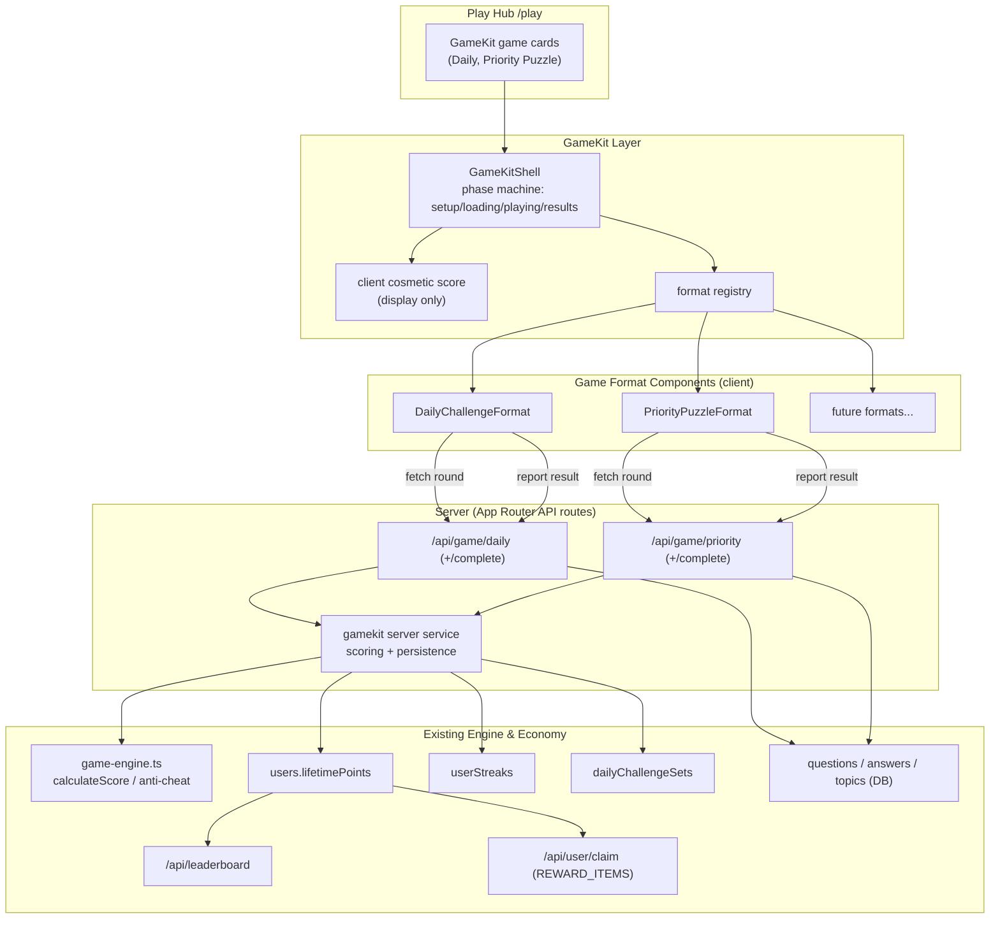
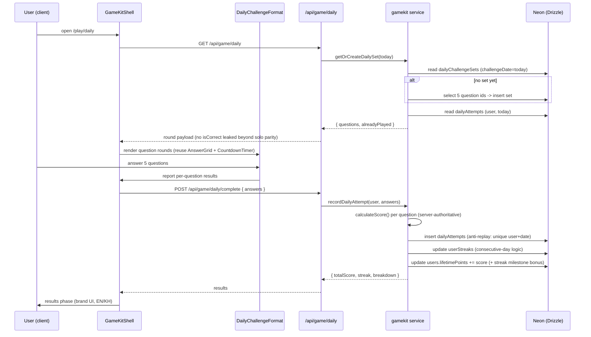
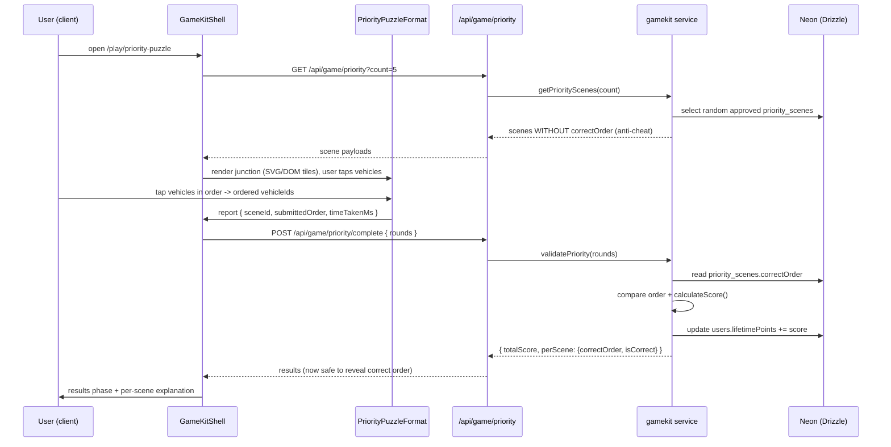

# Design Document: Traffic GameKit (`traffic-game-kit`)

## Overview

The **GameKit** is a reusable client + server abstraction layer for KWD that lets new road-safety mini-games plug into the *existing* engine (scoring, points, streaks, leaderboard, rewards) without re-implementing session lifecycle, scoring, or persistence. Each new game becomes a small **GameFormat** component that declares its config, renders one round, and reports a normalized result; the kit handles everything else.

This v1 ships the GameKit plus the **first two games** built on it:

1. **Daily Challenge** — 5 fixed questions per day, identical set for everyone, with a consecutive-day streak bonus. It is the retention driver and reuses the already-present `dailyChallengeSets` + `userStreaks` tables.
2. **Who Goes First? (Priority Puzzle)** — a junction scene shows 2–4 vehicles; the player taps vehicles in the correct right-of-way order. Highest educational value; trains the **Priority** category.

The design **builds on existing code** rather than reinventing it. The GameKit routes all scoring through `calculateScore` in `src/lib/game-engine.ts`, persists points the same way the live-challenge flow does (`users.lifetimePoints += score`), mirrors the solo phase state machine (`setup → loading → playing → results`) from `src/app/(public)/play/solo/page.tsx`, reuses `AnswerGrid` / `CountdownTimer`, pulls questions from the DB (not `data-content` files), and keeps every write server-side with anti-cheat already baked into the engine. UI is bilingual (EN/KH via `useLang()`) and brand-compliant (Brutalist, sharp corners, 2px black borders, hard offset shadows, Lucide icons only, no emoji).

### Goals

- A single `GameFormat<TConfig, TRound, TResult>` contract that any future mini-game implements.
- A `<GameKitShell>` client component that owns the phase machine, timing, scoring display, and result rendering so format authors write only round UI.
- Server-authoritative scoring and persistence reusing `calculateScore` and the `lifetimePoints` update pattern.
- Two complete games (Daily Challenge, Who Goes First?) wired into the play hub at `/play/daily` and `/play/priority-puzzle`.
- Smooth "game simulation" at 60fps on mobile + PC using only this web stack (DOM/SVG + CSS/Tailwind transitions, `requestAnimationFrame` where needed), no 3D/WebGL/heavy game-engine dependencies.
- Bilingual + brand-compliant throughout.

### Non-Goals (v1)

- No new currency, achievements, badges, power-ups, or tournaments (see *Future Concepts / Out of Scope for v1*).
- No realtime/multiplayer for these two games (they are single-player; Pusher stays reserved for the existing teacher-led live mode).
- No changes to the existing solo or live-challenge flows beyond adding hub entry points.
- No canvas/WebGL renderer.

---

## Architecture

The GameKit sits **between** the format components and the existing engine/economy. Formats never touch the DB, the scoring math, or the points table directly — they go through the kit.



**Key idea:** the kit is a *thin* layer. The server "gamekit service" is the only place that calls `calculateScore` and writes `lifetimePoints`, exactly mirroring `syncScoresToUserProfiles` in the live-challenge control route. Formats are pure presentation + input.

### Sequence: Daily Challenge round



### Sequence: Who Goes First? round



---

## Components and Interfaces

### Component: GameFormat (contract)

**Purpose**: The plug-in contract every mini-game implements. Generic over its config, the per-round data it consumes, and the per-round result it emits.

**Responsibilities**:
- Declare static metadata (id, route, hub card content EN/KH, brand color, Lucide icon).
- Declare runtime config (round count, timer behavior, whether timed).
- Render a single round and call `onRoundComplete` with a normalized result.
- Remain presentation-only: no DB, no scoring math, no points writes.

### Component: GameKitShell (client)

**Purpose**: Owns the phase state machine (`setup → loading → playing → results`) mirrored from `solo/page.tsx`, drives timing, keeps a *cosmetic* running score for HUD feedback, calls the format's `fetchRounds`, advances rounds, and POSTs to the format's complete endpoint for the **authoritative** score.

**Responsibilities**:
- Mount the active format from the registry by id.
- Manage loading/error/guest states (reuse the guest-mode banner pattern from solo).
- Render shared chrome: score chip, streak flame, progress bar, mute toggle, `CountdownTimer`.
- Persist results by POSTing to the format's `completePath`; always trust the server's `totalScore`.
- Respect `prefers-reduced-motion`.

### Component: gamekit server service

**Purpose**: The single server-side module (`src/lib/gamekit/server.ts`) that performs scoring via `calculateScore` and persistence (`lifetimePoints`, `userStreaks`, attempt tables). API routes are thin wrappers around it.

**Responsibilities**:
- `getSession()` auth gate (guests can play but are not persisted, matching solo).
- Per-question/per-scene scoring through `calculateScore` (anti-cheat included).
- Atomic `lifetimePoints` increment using the `sql\`${users.lifetimePoints} + ${score}\`` pattern.
- Daily anti-replay (one scored attempt per user per day) and streak update.

### Component: Hub integration

**Purpose**: Add GameKit cards to `/play`. Reuse the existing `GameCard` visual treatment; add a small `KIT` family badge and link to `/play/daily` and `/play/priority-puzzle`.

---

## Data Models

### Reused (no schema change)

- `dailyChallengeSets` — `{ id, challengeDate (text, unique), questionIds (int[]), createdAt }`. The daily set; one row per date, same for everyone.
- `userStreaks` — `{ userId (unique), currentStreak, longestStreak, lastPlayDate (text), ... }`. Consecutive-day streak state.
- `users.lifetimePoints` — rank/leaderboard currency, written via atomic SQL increment.
- `questions` / `answers` / `topics` / `categories` — question source (DB).

### New tables (Drizzle, add to `src/db/schema/content.ts`)

`dailyAttempts` enforces **one scored attempt per user per day** (anti-replay) and stores the breakdown.

```typescript
// src/db/schema/content.ts  (append; exported via schema/index.ts already)

export const dailyAttempts = pgTable(
  "daily_attempts",
  {
    id: serial("id").primaryKey(),
    userId: integer("user_id")
      .notNull()
      .references(() => users.id, { onDelete: "cascade" }),
    challengeDate: text("challenge_date").notNull(), // 'YYYY-MM-DD' (Asia/Phnom_Penh)
    setId: integer("set_id")
      .notNull()
      .references(() => dailyChallengeSets.id),
    score: integer("score").notNull().default(0),
    correctCount: integer("correct_count").notNull().default(0),
    totalQuestions: integer("total_questions").notNull().default(5),
    streakAfter: integer("streak_after").notNull().default(0),
    breakdown: text("breakdown"), // JSON: per-question {questionId, isCorrect, points}
    createdAt: timestamp("created_at").defaultNow().notNull(),
  },
  (table) => ({
    // Anti-replay: a user can only have ONE attempt per challenge date
    userDateUnique: unique("daily_attempts_user_date_unique").on(
      table.userId,
      table.challengeDate
    ),
  })
);

export type DailyAttempt = typeof dailyAttempts.$inferSelect;
export type NewDailyAttempt = typeof dailyAttempts.$inferInsert;
```

`priorityScenes` stores junction scene data for *Who Goes First?*. `correctOrder` is **never** sent to the client until results.

```typescript
// src/db/schema/content.ts  (append)

export const priorityScenes = pgTable("priority_scenes", {
  id: serial("id").primaryKey(),
  // Optional link to the Priority category/topic for educational grouping
  topicId: integer("topic_id").references(() => topics.id, { onDelete: "set null" }),
  titleEn: text("title_en").notNull().default(""),
  titleKm: text("title_km").notNull().default(""),
  // Junction layout descriptor (see PriorityScene type). JSON string.
  layout: text("layout").notNull(), // JSON: { junction, vehicles[] }
  // Correct right-of-way order: array of vehicleIds, SERVER-ONLY
  correctOrder: text("correct_order").notNull(), // JSON: string[]
  // Bilingual explanation shown on results
  explanationEn: text("explanation_en").notNull().default(""),
  explanationKm: text("explanation_km").notNull().default(""),
  difficulty: text("difficulty").default("medium"), // easy | medium | hard
  status: text("status").notNull().default("draft"), // draft | approved | inactive
  createdBy: integer("created_by").references(() => users.id),
  createdAt: timestamp("created_at").defaultNow().notNull(),
  updatedAt: timestamp("updated_at").defaultNow().notNull(),
});

export type PriorityScene = typeof priorityScenes.$inferSelect;
export type NewPriorityScene = typeof priorityScenes.$inferInsert;
```

**Validation rules**
- `dailyAttempts`: `(userId, challengeDate)` unique; `challengeDate` computed server-side in `Asia/Phnom_Penh`, never trusted from client.
- `priorityScenes.layout`: 2–4 vehicles; each vehicle id unique within scene; `correctOrder` is a permutation of all vehicle ids.
- `correctOrder` and `answers.isCorrect` (for daily) are stripped from any client-facing payload before scoring.

---

## GameKit Contract (Low-Level Types)

```typescript
// src/lib/gamekit/types.ts

import type { ComponentType } from "react";
import type { LucideIcon } from "lucide-react";

export type Lang = "en" | "kh";

/** Bilingual string pair used everywhere in the kit. */
export interface I18nText {
  en: string;
  kh: string;
}

/** Static, build-time metadata describing a game for the hub + routing. */
export interface GameFormatMeta {
  id: string;                 // e.g. "daily", "priority-puzzle"
  route: string;              // e.g. "/play/daily"
  title: I18nText;
  description: I18nText;
  brandColor: string;         // on-palette hex (e.g. BRAND.purple)
  Icon: LucideIcon;           // Lucide only — no emoji
  badge?: I18nText;           // hub card chip, e.g. {en:"DAILY", kh:"ប្រចាំថ្ងៃ"}
}

/** Runtime config a format requests from the shell. */
export interface GameFormatConfig {
  timed: boolean;             // does each round run a CountdownTimer?
  secondsPerRound: number;    // used only when timed
  scoringMode: "speed" | "equal"; // forwarded to calculateScore
  showStreakHud: boolean;     // show the streak flame chip
}

/** Normalized result a format emits for ONE round. */
export interface RoundResult {
  /** Stable id of the round subject (questionId or sceneId). */
  refId: number;
  /** Client's correctness guess — server re-validates; used for cosmetic HUD only. */
  isCorrectGuess: boolean;
  /** Opaque per-format payload the server needs to re-validate & score. */
  payload: Record<string, unknown>;
  timeTakenMs: number;
  /** Difficulty (forwarded to calculateScore); may be null. */
  difficulty?: string | null;
}

/** Props the shell passes into every format's round renderer. */
export interface RoundViewProps<TRound> {
  round: TRound;
  index: number;
  total: number;
  lang: Lang;
  muted: boolean;
  /** Call exactly once when the user completes this round. */
  onRoundComplete: (result: RoundResult) => void;
}

/** The plug-in contract. TRound = per-round data; TResult = server result shape. */
export interface GameFormat<TRound, TResult> {
  meta: GameFormatMeta;
  config: GameFormatConfig;
  /** Client fetch of rounds (calls the format's GET API). */
  fetchRounds: () => Promise<{ rounds: TRound[]; alreadyPlayed?: boolean }>;
  /** Server path the shell POSTs RoundResult[] to for authoritative scoring. */
  completePath: string;
  /** The per-round UI (reuses AnswerGrid / CountdownTimer where useful). */
  RoundView: ComponentType<RoundViewProps<TRound>>;
  /** Optional custom results view; falls back to shared brand results screen. */
  ResultView?: ComponentType<{ result: TResult; lang: Lang }>;
}

/** Shared authoritative result returned by every complete endpoint. */
export interface KitCompletionResult {
  totalScore: number;
  correctAnswers: number;
  totalRounds: number;
  perRound: { refId: number; isCorrect: boolean; pointsEarned: number }[];
  persisted: boolean;         // false for guests
}
```

### Shell phase machine (mirrors `solo/page.tsx`)

```typescript
// src/lib/gamekit/types.ts (continued)

export type KitPhase<TRound, TResult> =
  | { name: "setup" }
  | { name: "loading" }
  | {
      name: "playing";
      rounds: TRound[];
      index: number;
      cosmeticScore: number;
      streak: number;
    }
  | { name: "results"; result: TResult & KitCompletionResult };
```

### Daily Challenge types

```typescript
// src/lib/gamekit/formats/daily/types.ts

export interface DailyRound {
  questionId: number;
  questionEn: string;
  questionKm: string;
  topicCode: string | null;
  imageUrl: string | null;          // Cloudinary; optimized via cloudinaryOptimize
  gameType: "mcq" | "true_false" | "image_pick";
  difficulty: string | null;
  // NOTE: isCorrect is included per existing solo parity but the server
  // re-derives correctness from the DB; never trusts the client.
  answers: { id: number; answerEn: string; answerKm: string; imageUrl: string | null; isCorrect: boolean }[];
}

export interface DailyCompletionResult extends KitCompletionResult {
  currentStreak: number;
  longestStreak: number;
  streakBonusAwarded: number;       // milestone bonus on top of per-question score
  alreadyPlayed: boolean;
}
```

### Priority Puzzle (Who Goes First?) scene schema

```typescript
// src/lib/gamekit/formats/priority/types.ts

export type LaneDir = "north" | "south" | "east" | "west";
export type JunctionKind = "cross" | "t_junction" | "roundabout";

export interface VehiclePlacement {
  id: string;                 // unique within scene, e.g. "v1"
  approach: LaneDir;          // which arm the vehicle sits on
  intent: "straight" | "left" | "right";
  kind: "car" | "truck" | "moto" | "ambulance" | "bus";
  /** 0..1 normalized position along the approach for rendering. */
  pos: number;
}

export interface JunctionLayout {
  junction: JunctionKind;
  hasTrafficLight: boolean;
  vehicles: VehiclePlacement[]; // length 2..4
}

/** Client-facing scene — NO correctOrder. */
export interface PriorityRound {
  sceneId: number;
  titleEn: string;
  titleKm: string;
  layout: JunctionLayout;
  difficulty: string | null;
}

/** Per-round payload the client submits (the tapped order). */
export interface PriorityRoundPayload extends Record<string, unknown> {
  submittedOrder: string[];   // vehicleIds in tapped order
}

export interface PriorityCompletionResult extends KitCompletionResult {
  perScene: {
    sceneId: number;
    submittedOrder: string[];
    correctOrder: string[];   // revealed only after completion
    isCorrect: boolean;
    explanationEn: string;
    explanationKm: string;
  }[];
}
```

---

## Key Functions with Formal Specifications

### `getOrCreateDailySet(today: string): Promise<DailyChallengeSet>` (server)

```typescript
function getOrCreateDailySet(today: string): Promise<DailyChallengeSet>
```

**Preconditions**
- `today` is a valid `YYYY-MM-DD` string computed server-side in `Asia/Phnom_Penh`.
- DB reachable; `questions` has ≥ 5 approved rows.

**Postconditions**
- Returns the unique `dailyChallengeSets` row for `today`.
- If none existed, exactly one row is created with 5 distinct `questionIds`; concurrent creators do not produce duplicates (the `challengeDate` unique constraint + on-conflict re-read guarantees a single set).
- No side effects on user state.

**Loop invariants**: when selecting the 5 question ids, the accumulated set contains only distinct ids drawn from approved questions.

### `recordDailyAttempt(userId, today, setId, answers): Promise<DailyCompletionResult>` (server)

```typescript
function recordDailyAttempt(
  userId: number,
  today: string,
  setId: number,
  answers: RoundResult[]
): Promise<DailyCompletionResult>
```

**Preconditions**
- `userId` references an existing user (guests are handled before this call).
- `answers` correspond to questions in set `setId` (server re-fetches the questions; client ids are validated against the set).

**Postconditions**
- If the user already has a `dailyAttempts` row for `today`: **no points change**, returns `alreadyPlayed = true` with the prior breakdown (anti-replay).
- Otherwise: exactly one `dailyAttempts` row inserted; `userStreaks` updated by consecutive-day rule; `users.lifetimePoints` increased by `Σ calculateScore(...) + streakBonus`.
- All writes are idempotent under the unique `(userId, challengeDate)` constraint: a duplicate concurrent submit fails the insert and is treated as `alreadyPlayed`.

**Loop invariants**: while summing per-question scores, `streak` equals the count of consecutive correct answers up to the current question, and `totalScore` equals the sum of `calculateScore` results processed so far.

### `validatePriority(rounds: PriorityRoundPayload[]): Promise<PriorityCompletionResult>` (server)

```typescript
function validatePriority(
  userId: number | null,
  rounds: { sceneId: number; submittedOrder: string[]; timeTakenMs: number }[]
): Promise<PriorityCompletionResult>
```

**Preconditions**
- Each `sceneId` references an `approved` `priorityScenes` row.
- Each `submittedOrder` is a permutation of that scene's vehicle ids (else that round scores 0, not an error).

**Postconditions**
- `isCorrect` for a scene is `true` iff `submittedOrder` deep-equals the scene's `correctOrder`.
- `totalScore = Σ calculateScore({ isCorrect, difficulty, scoringMode, ... })`.
- If `userId` is non-null, `users.lifetimePoints` increased by `totalScore`; guests get `persisted = false` and no write.
- `correctOrder` and explanations are included in the response only after scoring.

**Loop invariants**: `totalScore` equals the sum of awarded points for all scenes validated so far; no scene is scored twice.

### `computeStreak(prev: UserStreak | null, today: string): { current, longest }` (pure)

```typescript
function computeStreak(prev: UserStreak | null, today: string): { current: number; longest: number }
```

**Preconditions**: `today` is `YYYY-MM-DD`; `prev.lastPlayDate` (if present) is `YYYY-MM-DD`.

**Postconditions**
- If `prev` is null or `lastPlayDate` is not yesterday and not today → `current = 1`.
- If `lastPlayDate === yesterday` → `current = prev.currentStreak + 1`.
- If `lastPlayDate === today` → unchanged (defensive; anti-replay should prevent this).
- `longest = max(prev.longest, current)`. Pure; no I/O.

---

## Algorithmic Pseudocode

### Daily set generation + attempt recording (server)

```typescript
// POST /api/game/daily/complete  ->  gamekit service

async function recordDailyAttempt(userId, today, setId, answers) {
  // ASSERT: today computed server-side (Asia/Phnom_Penh), not from client

  // 1. Anti-replay guard (fast path)
  const existing = await db.select().from(dailyAttempts)
    .where(and(eq(dailyAttempts.userId, userId), eq(dailyAttempts.challengeDate, today)))
    .limit(1);
  if (existing.length) return toResult(existing[0], { alreadyPlayed: true });

  // 2. Re-fetch the authoritative set + correct answers from DB (never trust client)
  const set = await getDailySetById(setId);
  const correctByQuestion = await loadCorrectAnswers(set.questionIds);

  // 3. Score server-side via the existing engine
  let totalScore = 0, correctCount = 0, streak = 0;
  const perRound = [];
  for (const q of set.questionIds) {            // INVARIANT: only set questions are scored
    const a = answers.find(x => x.refId === q);
    const isCorrect = !!a && correctByQuestion.get(q) === a.payload.answerId;
    if (isCorrect) { streak++; correctCount++; } else { streak = 0; }
    const remainingTimeMs = max(0, DAILY_TOTAL_MS - (a?.timeTakenMs ?? DAILY_TOTAL_MS));
    const s = calculateScore({
      isCorrect, difficulty: a?.difficulty ?? "medium",
      scoringMode: "speed", remainingTimeMs, totalTimeMs: DAILY_TOTAL_MS,
      currentStreak: streak,
    });
    totalScore += s.totalPoints;
    perRound.push({ refId: q, isCorrect, pointsEarned: s.totalPoints });
  }

  // 4. Streak (consecutive-day) update + milestone bonus
  const prev = await getUserStreak(userId);
  const { current, longest } = computeStreak(prev, today);
  const streakBonus = streakMilestoneBonus(current);   // e.g. +5 at 7-day, +15 at 30-day
  totalScore += streakBonus;

  // 5. Persist atomically: insert attempt (unique guard) + streak + points
  try {
    await db.insert(dailyAttempts).values({
      userId, challengeDate: today, setId, score: totalScore,
      correctCount, totalQuestions: set.questionIds.length,
      streakAfter: current, breakdown: JSON.stringify(perRound),
    });
  } catch (e) {
    if (isUniqueViolation(e)) return toResultAlreadyPlayed(userId, today); // race -> replay
    throw e;
  }
  await upsertUserStreak(userId, { currentStreak: current, longestStreak: longest, lastPlayDate: today });
  await db.update(users)
    .set({ lifetimePoints: sql`${users.lifetimePoints} + ${totalScore}`,
           updatedAt: new Date() })
    .where(eq(users.id, userId));

  return { totalScore, correctAnswers: correctCount, totalRounds: set.questionIds.length,
           perRound, persisted: true, currentStreak: current, longestStreak: longest,
           streakBonusAwarded: streakBonus, alreadyPlayed: false };
}
```

### Priority order validation (server)

```typescript
// POST /api/game/priority/complete -> gamekit service

async function validatePriority(userId, rounds) {
  const sceneIds = rounds.map(r => r.sceneId);
  const scenes = await loadApprovedScenes(sceneIds);   // includes correctOrder (server-only)
  const sceneById = index(scenes, "id");

  let totalScore = 0, correctCount = 0;
  const perScene = [];
  for (const r of rounds) {                              // INVARIANT: each scene scored once
    const scene = sceneById.get(r.sceneId);
    if (!scene) continue;
    const correctOrder = JSON.parse(scene.correctOrder);
    const isPermutation = sameMultiset(r.submittedOrder, vehicleIds(scene));
    const isCorrect = isPermutation && arrayEquals(r.submittedOrder, correctOrder);
    if (isCorrect) correctCount++;
    const remainingTimeMs = max(0, PRIORITY_TOTAL_MS - r.timeTakenMs);
    const s = calculateScore({
      isCorrect, difficulty: scene.difficulty ?? "medium",
      scoringMode: "speed", remainingTimeMs, totalTimeMs: PRIORITY_TOTAL_MS,
      currentStreak: correctCount,            // streak = running correct count
    });
    totalScore += s.totalPoints;
    perScene.push({ sceneId: scene.id, submittedOrder: r.submittedOrder, correctOrder,
                    isCorrect, explanationEn: scene.explanationEn, explanationKm: scene.explanationKm });
  }

  let persisted = false;
  if (userId) {
    await db.update(users).set({ lifetimePoints: sql`${users.lifetimePoints} + ${totalScore}`,
                                 updatedAt: new Date() }).where(eq(users.id, userId));
    persisted = true;
  }
  return { totalScore, correctAnswers: correctCount, totalRounds: rounds.length,
           perRound: perScene.map(p => ({ refId: p.sceneId, isCorrect: p.isCorrect, pointsEarned: 0 })),
           perScene, persisted };
}
```

### Client round loop (GameKitShell, mirrors solo)

```typescript
// src/lib/gamekit/GameKitShell.tsx (pseudocode)

function GameKitShell({ format }) {
  const { lang } = useLang();
  const [phase, setPhase] = useState({ name: "setup" });
  const answersRef = useRef([]);            // RoundResult[]

  async function start() {
    setPhase({ name: "loading" });
    const { rounds, alreadyPlayed } = await format.fetchRounds();
    if (alreadyPlayed) { /* show "come back tomorrow" brand panel */ return; }
    answersRef.current = [];
    setPhase({ name: "playing", rounds, index: 0, cosmeticScore: 0, streak: 0 });
  }

  function onRoundComplete(result) {        // called by format's RoundView
    answersRef.current.push(result);
    // cosmetic-only HUD update using same rules as solo (server is authoritative)
    updateCosmeticScore(result);
    const next = phase.index + 1;
    if (next >= phase.rounds.length) return complete();
    setPhase(p => ({ ...p, index: next }));
  }

  async function complete() {
    const res = await fetch(format.completePath, {
      method: "POST", headers: { "Content-Type": "application/json" },
      body: JSON.stringify({ rounds: answersRef.current }),
    });
    const result = await res.json();        // authoritative totalScore
    setPhase({ name: "results", result });
  }

  // render: setup/loading -> shared chrome + <format.RoundView/> -> results
}
```

---

## Example Usage

### Defining the Daily Challenge format

```typescript
// src/lib/gamekit/formats/daily/index.ts
import { CalendarDays } from "lucide-react";
import type { GameFormat } from "@/lib/gamekit/types";
import type { DailyRound, DailyCompletionResult } from "./types";
import { DailyRoundView } from "./DailyRoundView";

export const dailyFormat: GameFormat<DailyRound, DailyCompletionResult> = {
  meta: {
    id: "daily",
    route: "/play/daily",
    title: { en: "Daily Challenge", kh: "បញ្ហាប្រចាំថ្ងៃ" },
    description: { en: "5 questions. Same for everyone. Keep your streak alive.",
                   kh: "សំណួរ៥ ដូចគ្នាសម្រាប់អ្នករាល់គ្នា — រក្សាស្ទ្រីករបស់អ្នក។" },
    brandColor: "#a855f7",      // purple = special mode (on-palette)
    Icon: CalendarDays,
    badge: { en: "DAILY", kh: "ប្រចាំថ្ងៃ" },
  },
  config: { timed: true, secondsPerRound: 30, scoringMode: "speed", showStreakHud: true },
  fetchRounds: async () => {
    const r = await fetch("/api/game/daily");
    return r.json();           // { rounds, alreadyPlayed }
  },
  completePath: "/api/game/daily/complete",
  RoundView: DailyRoundView,   // reuses <AnswerGrid> + <CountdownTimer>
};
```

### Mounting a game page

```typescript
// src/app/(public)/play/daily/page.tsx
"use client";
import { GameKitShell } from "@/lib/gamekit/GameKitShell";
import { dailyFormat } from "@/lib/gamekit/formats/daily";

export default function DailyPage() {
  return <GameKitShell format={dailyFormat} />;
}
```

### Registering formats + hub cards

```typescript
// src/lib/gamekit/registry.ts
import { dailyFormat } from "./formats/daily";
import { priorityFormat } from "./formats/priority";

export const GAMEKIT_FORMATS = [dailyFormat, priorityFormat] as const;
// /play maps GAMEKIT_FORMATS -> existing <GameCard> with meta.title/description/Icon/brandColor
```

---

## Correctness Properties

These are universal statements the implementation must satisfy (they drive the Testing Strategy).

### Property 1: Server-authoritative scoring
∀ submissions, the persisted `lifetimePoints` delta equals `Σ calculateScore(server-derived correctness)`; the client's `isCorrectGuess`/cosmetic score never affects persistence.

**Validates: Requirements 2.1, 2.2, 2.3, 2.4, 9.2**

### Property 2: Daily anti-replay
∀ user u, ∀ date d, at most one `dailyAttempts` row exists for `(u, d)`, and `lifetimePoints` is incremented at most once for `(u, d)` even under concurrent submits.

**Validates: Requirements 4.2, 4.3, 4.4**

### Property 3: Streak monotonic correctness
`computeStreak` yields `current = prev+1` iff `lastPlayDate` is exactly yesterday; resets to `1` on any gap; `longest ≥ current` always.

**Validates: Requirements 5.1, 5.2, 5.4**

### Property 4: Priority order exactness
A Priority round is scored correct iff the submitted order is a permutation of the scene's vehicles AND equals `correctOrder` element-for-element.

**Validates: Requirements 7.1, 6.2**

### Property 5: No secret leakage
No client-facing payload from `/api/game/priority` contains `correctOrder`; no daily payload is scored using client-supplied `isCorrect`.

**Validates: Requirements 8.1, 8.2, 8.3**

### Property 6: Guest safety
Guests can play both games (parity with solo) but produce zero DB writes (`persisted = false`).

**Validates: Requirements 10.2, 10.4**

### Property 7: Bilingual completeness
Every user-visible string resolves in both `en` and `kh`.

**Validates: Requirements 11.1, 11.3, 11.4**

---

## Error Handling

### Scenario: No daily set and < 5 approved questions
**Condition**: `getOrCreateDailySet` cannot find 5 distinct approved questions.
**Response**: 503 with bilingual message; hub card shows "unavailable today" state.
**Recovery**: retry next request; admin adds approved questions.

### Scenario: Duplicate daily submit (race / double-tap)
**Condition**: second POST arrives for same `(userId, today)`.
**Response**: unique-constraint violation caught; return prior attempt with `alreadyPlayed = true`, HTTP 200.
**Recovery**: client shows the existing result, no double points.

### Scenario: Tampered Priority submission
**Condition**: `submittedOrder` contains unknown/duplicate vehicle ids.
**Response**: that scene scores 0 (treated as wrong), not a 4xx, so a malformed round can't crash the run.
**Recovery**: results screen still renders with `isCorrect = false` and the explanation.

### Scenario: Complete endpoint fails after questions answered
**Condition**: network/DB error on POST `/complete`.
**Response**: shell falls back to the cosmetic score for display (matching solo's fallback) and flags `persisted = false`.
**Recovery**: user may replay (daily still guarded by anti-replay on the server).

### Scenario: Guest plays Daily
**Condition**: no session.
**Response**: allow play, show guest banner (reuse solo banner), `persisted = false`, no streak update.

---

## Testing Strategy

### Unit Testing
- `computeStreak`: yesterday → +1, gap → reset, same-day → unchanged, longest tracking.
- `calculateScore` integration wrappers: suspicious (<500ms) → no speed/streak bonus (already enforced by engine).
- Order comparison helpers: `sameMultiset`, `arrayEquals` for permutation + exact-order checks.

### Property-Based Testing
**Library**: `fast-check` (TypeScript/Jest ecosystem).

- *Anti-replay*: for any sequence of N submits for the same `(user, date)`, total `lifetimePoints` delta equals exactly one attempt's score. (Property 2)
- *Scoring authority*: for arbitrary client-claimed scores, persisted delta is independent of the client claim and equals the server recomputation. (Property 1)
- *Streak*: for arbitrary ordered date sequences, `current` resets exactly on gaps and increments on consecutive days; `longest = running max`. (Property 3)
- *Priority exactness*: for random vehicle sets and random submitted permutations, `isCorrect` is true iff the permutation equals `correctOrder`. (Property 4)
- *No leakage*: for any scene, the serialized GET payload never contains the `correctOrder` key. (Property 5)

### Integration Testing
- `/api/game/daily` GET creates exactly one set per date under concurrency.
- Full daily run for an authenticated user updates `dailyAttempts`, `userStreaks`, and `lifetimePoints` consistently; a second run is a no-op.
- `/api/game/priority/complete` reveals `correctOrder` only in the response, persists points for users, not guests.

---

## Performance / Simulation Budget

The "game simulation" must be smooth on mobile + PC using **only this web stack** — no canvas/WebGL, no 3D, no new game-engine dependency.

**Device & performance budget**
- Target **60fps** (≤16ms/frame) on a mid-range Android (e.g. ~2021 device) and any desktop browser.
- Per-game JS payload added: keep each format chunk **lazy-loaded** (`next/dynamic`) and small; no new heavy deps. Reuse **GSAP only if already present** in the project — otherwise use CSS/Tailwind transitions (the brand already uses cubic-bezier transitions in `play/page.tsx`).
- Initial route interactive < ~2.5s on 3G-fast; images via **`cloudinaryOptimize`** (`f_auto,q_auto,w_<n>,c_limit`).

**Rendering approach for *Who Goes First?* (explicit)**
- The junction scene is rendered with **inline SVG for the road/junction** plus **absolutely-positioned DOM tiles** for vehicles — **not** canvas/WebGL. Vehicles are brand-styled brutalist tiles (2px black border, hard offset shadow, Lucide vehicle icons) positioned with `transform: translate()` so movement/selection animates on the GPU compositor.
- Selection ordering is pure state + CSS; tapping a vehicle stamps an order badge (1,2,3,4). No physics, no continuous simulation loop required.
- Where a brief animated cue is wanted (e.g. a vehicle "goes" on reveal), use a short `transform`/`opacity` transition or a single `requestAnimationFrame`-driven tween bounded to a few hundred ms — never a persistent RAF loop.

**Cross-device parity & a11y**
- **Touch + click parity**: handlers use `onPointerDown`/`onClick` so taps and mouse clicks behave identically; tap targets ≥ 44px.
- **`prefers-reduced-motion`**: the shell and formats gate non-essential transitions behind a `prefers-reduced-motion: no-preference` check; reduced mode shows instant state changes.
- Lightweight DOM: cap scene to ≤ 4 vehicles + junction = small node count; daily reuses the existing solo DOM which already performs well.
- Layout stability: reuse solo's fixed-height slots (image area, question card, answer grid, feedback slot) to avoid layout shift between rounds.

---

## Security Considerations

- All scoring and validation are **server-side only** (`src/lib/gamekit/server.ts`); routes call `getSession()` and never expose secrets client-side.
- `correctOrder` (Priority) and per-question correctness (Daily) are never sent before scoring.
- Anti-cheat: the engine already zeroes speed/streak bonuses for `<500ms` responses; the kit forwards true `timeTakenMs` and clamps it server-side (same clamp as `calculateScore`).
- Anti-replay enforced by DB unique constraint, not just app logic.
- `lifetimePoints` writes use atomic SQL increments (`sql\`... + ${score}\``) to avoid lost updates, matching `syncScoresToUserProfiles`.
- `challengeDate` is computed server-side; client-supplied dates are ignored.

---

## How It Plugs Into the Play Hub and Routes

- **Hub**: `/play` maps `GAMEKIT_FORMATS` into the existing `GameCard` component (same brutalist banner, meta chips, difficulty dots, PLAY CTA), adding a small `KIT` family chip. EN/KH from `meta.title/description`.
- **Routes**:
  - `/play/daily` → `<GameKitShell format={dailyFormat} />`
  - `/play/priority-puzzle` → `<GameKitShell format={priorityFormat} />`
- **Shared chrome** (score chip, streak flame, progress bar, mute, `CountdownTimer`) lives in `GameKitShell`, mirroring the solo HUD.

### API Route List

| Method | Path | Purpose | Auth |
|--------|------|---------|------|
| GET | `/api/game/daily` | Get/create today's set; return 5 rounds + `alreadyPlayed` | Optional (guest allowed; `alreadyPlayed`/streak only for users) |
| POST | `/api/game/daily/complete` | Score 5 answers server-side, record attempt (anti-replay), update streak + `lifetimePoints` | Optional (guests: no persistence) |
| GET | `/api/game/priority?count=5` | Fetch N random approved scenes **without** `correctOrder` | Optional |
| POST | `/api/game/priority/complete` | Validate tapped orders, score via `calculateScore`, persist points; reveal `correctOrder` in response | Optional (guests: no persistence) |

All four are thin App Router handlers delegating to `src/lib/gamekit/server.ts`.

### Points / Anti-Cheat Rules (reuse of `calculateScore`)

- Base points by difficulty (easy 1 / med 2 / hard 3), `+speedBonus` (speed mode, first-half answers), `+streakBonus` (2–4 → +1, 5+ → +2) — **all from `calculateScore`**, unchanged.
- Daily adds a **consecutive-day milestone bonus** (e.g. +5 at 7-day, +15 at 30-day) on top, applied once per qualifying attempt.
- Suspicious `<500ms` answers get zero speed/streak bonus (engine-enforced).
- Persisted via `users.lifetimePoints += totalScore`, feeding the existing rank tiers (`rank-utils.ts`), leaderboard, and rewards claim flow — no parallel point system in v1.

---

## Future Concepts / Out of Scope for v1

Captured for later; **not** built in v1 so the kit + 2 games stay focused:

- **Achievements / badges** — milestone unlocks (first daily, 7-day streak, 100% Priority round).
- **Daily streak reward milestones** — escalating rewards at 3/7/30 days (beyond the simple bonus above).
- **Spendable coin currency** — a `coins` balance separate from `lifetimePoints` (which stays the rank/leaderboard metric); coins earned per game, spent in a shop. Would add a `users.coins` column + ledger table.
- **Power-ups** — e.g. "50/50", "freeze timer", "skip" purchasable with coins.
- **Weekly tournament** — time-boxed leaderboard with seasonal reset, likely reusing Pusher for live standings.
- **More formats** — sign-matching, scenario "spot the hazard", parking/road-marking games — each just a new `GameFormat`.

These are intentionally deferred. The GameKit contract is designed so each can be added as a new format (and, where needed, a small additive schema change) without touching the engine or the two v1 games.


---

# Addendum: Kid Games Pack (v1.1)

This addendum **adds** four kid-focused games to the GameKit and introduces a 3-tier **access model**. It does **not** replace anything: the existing "Pick your game mode" list (Quick Quiz, Speed Round, Sign Challenge, Mixed Practice, Category Quiz, Live Game) and the v1 GameKit games (Daily Challenge, Who Goes First?) all remain. The four new games are new `GameFormat`s appended to the registry, so they appear as additional cards in the hub.

## New Games (all built as GameFormats)

| # | Game | id / route | Concept | Access tier |
|---|------|-----------|---------|-------------|
| 1 | **Sign Match** | `sign-match` · `/play/sign-match` | Flip-card memory: match a road sign to its meaning. Fewer flips = more points. | `user` |
| 2 | **Catch the Sign** | `catch-sign` · `/play/catch-sign` | Reaction game: signs appear; tap the one the prompt asks for ("Tap the STOP sign"). | `user` |
| 3 | **Traffic Light Hero** | `light-hero` · `/play/light-hero` | Tap the correct action for the current light (green=go, red=stop, yellow=slow). | `user` |
| 4 | **Road Safety Adventure** ⭐ | `safety-adventure` · `/play/safety-adventure` | Guided multi-step journey ("get to school safely") making correct choices at crossings/signs. The premium game. | `class-pro` |

All four are kid-friendly (bright on-palette colors, large tap targets ≥44px, forgiving pacing), bilingual EN/KH, brand-compliant (Brutalist, Lucide icons only, no emoji), and reuse `calculateScore` + `lifetimePoints` exactly like the v1 games. They reuse questions/signs from the DB (`questions`/`answers`/`topics`, served via existing/new GET endpoints) and `cloudinaryOptimize` for images. Rendering stays SVG/DOM + CSS transitions (no canvas/WebGL), 60fps budget.

## Access Model (3 tiers)

Access is declared per format via a new `accessTier` field on `GameFormatMeta`. The GameKit enforces it both client-side (gating UI) and server-side (authoritative).

| Tier | Who may play | Score recorded? |
|------|--------------|-----------------|
| `guest` | Anyone (no login) | **No** — `persisted: false`, zero DB writes |
| `user` | Anyone; **logged-in users** get their score saved | Saved only when authenticated; guests play free, unrecorded |
| `class-pro` | **Student linked to a teacher's class AND that teacher has an active `teacher_pro` or `school` subscription** | Saved; otherwise the game is **locked** (shows "ask your teacher to unlock") |

Rules:
- **Free access for guests** on `guest` and `user` tier games — they can always play, but no score is recorded (matches the existing solo guest behavior).
- **`user` tier**: a logged-in user's completion is recorded (`lifetimePoints += score`); a guest's is not.
- **`class-pro` tier** (Road Safety Adventure): the server verifies (a) an authenticated **student**, (b) at least one active `classEnrollments` row linking the student to a class, and (c) the owning teacher of that class has a **non-expired `teacher_pro`/`school`** subscription. If any check fails → `403 locked` with a bilingual "ask your teacher" message; the hub card shows a Lock state. Guests/anonymous cannot play this game at all.

### Reused existing tables for access
- `users.role` (student/teacher) — from `src/db/schema/users.ts`.
- `classes` + `classEnrollments` — the student↔class↔teacher link (already in schema).
- `subscriptions` (plan: `free`/`teacher_pro`/`school`, status, expiry) — `src/db/schema/subscriptions.ts`; reuse the same check logic as `/api/subscriptions/check`.

No new tables are strictly required for access. A generic **`gameAttempts`** table is added to record non-daily kid-game plays (the daily game keeps using `dailyAttempts`).

```typescript
// src/db/schema/content.ts (append)
export const gameAttempts = pgTable("game_attempts", {
  id: serial("id").primaryKey(),
  userId: integer("user_id").references(() => users.id, { onDelete: "cascade" }), // null = guest (not persisted anyway)
  gameId: text("game_id").notNull(),          // GameFormat id, e.g. "sign-match"
  score: integer("score").notNull().default(0),
  correctCount: integer("correct_count").notNull().default(0),
  totalRounds: integer("total_rounds").notNull().default(0),
  breakdown: text("breakdown"),               // JSON per-round
  createdAt: timestamp("created_at").defaultNow().notNull(),
}, (t) => ({
  userGameIdx: index("game_attempts_user_game_idx").on(t.userId, t.gameId),
}));
export type GameAttempt = typeof gameAttempts.$inferSelect;
export type NewGameAttempt = typeof gameAttempts.$inferInsert;
```

## Contract additions

```typescript
// src/lib/gamekit/types.ts (extend)

export type AccessTier = "guest" | "user" | "class-pro";

// add to GameFormatMeta:
//   accessTier: AccessTier;

/** Result of the server access gate. */
export interface AccessDecision {
  allowed: boolean;
  reason?: "guest_ok_no_record" | "needs_login" | "needs_class" | "needs_teacher_pro";
  willRecord: boolean;             // whether a completion will persist
  message?: I18nText;              // bilingual lock/notice message
}
```

## Server access gate (single source of truth)

```typescript
// src/lib/gamekit/access.ts  (server)

async function resolveAccess(tier: AccessTier, session: Session | null): Promise<AccessDecision> {
  switch (tier) {
    case "guest":
      return { allowed: true, willRecord: !!session };           // logged-in still records via gameAttempts
    case "user":
      return session
        ? { allowed: true, willRecord: true }
        : { allowed: true, willRecord: false, reason: "guest_ok_no_record" }; // free play, no record
    case "class-pro": {
      if (!session) return { allowed: false, willRecord: false, reason: "needs_login",
                             message: LOCK_MSG.needsLogin };
      if (session.role !== "student") return { allowed: false, willRecord: false,
                             reason: "needs_class", message: LOCK_MSG.studentsOnly };
      const cls = await getActiveEnrollmentWithTeacher(session.id);   // classEnrollments ⨝ classes
      if (!cls) return { allowed: false, willRecord: false, reason: "needs_class",
                         message: LOCK_MSG.needsClass };
      const pro = await teacherHasActivePro(cls.teacherId);           // subscriptions: teacher_pro|school, not expired
      if (!pro) return { allowed: false, willRecord: false, reason: "needs_teacher_pro",
                         message: LOCK_MSG.needsTeacherPro };
      return { allowed: true, willRecord: true };
    }
  }
}
```

- Every kid-game GET (`/api/game/<id>`) calls `resolveAccess`; a `class-pro` game returns `403` with the bilingual `message` when not allowed.
- Every complete endpoint re-runs `resolveAccess`; it only writes `gameAttempts` + `lifetimePoints` when `willRecord` is true. This keeps the "guests don't record / Pro-gated game" rules **server-authoritative**, not client-trusted.
- `lifetimePoints` increments stay atomic (`sql\`... + ${score}\``), feeding the same rank/leaderboard/rewards economy.

## Hub integration

- The four formats are appended to `GAMEKIT_FORMATS`; the hub maps them into the existing `GameCard`. **The existing mode cards are untouched.**
- A `class-pro` card with no access renders a **Lock badge** (Lucide `Lock`) and, on click, shows the bilingual "ask your teacher to unlock / upgrade to Teacher Pro" panel (reuse the existing `UpgradeModal` / Teacher-Pro messaging pattern).

## API additions

| Method | Path | Purpose | Access |
|--------|------|---------|--------|
| GET | `/api/game/[gameId]` | Fetch rounds for a kid game (sign-match, catch-sign, light-hero, safety-adventure) | gate via `resolveAccess(tier)` |
| POST | `/api/game/[gameId]/complete` | Validate + score server-side; record to `gameAttempts` + `lifetimePoints` only when `willRecord` | gate via `resolveAccess(tier)` |

These can be a single dynamic `[gameId]` route pair that dispatches by id, or per-game routes — both delegate to the gamekit server service and `resolveAccess`.

## Performance / kid UX notes

- Same 60fps budget; SVG + absolutely-positioned DOM tiles, GPU `transform` transitions, `prefers-reduced-motion`, touch+click parity, ≥44px targets.
- Sign Match: pure state + CSS flip (`transform: rotateY`); no timers required to be smooth.
- Catch the Sign / Traffic Light Hero: short, bounded `setTimeout`/transition cues — never a persistent RAF loop.
- Road Safety Adventure: a stepped scene sequence (each step is a "round"); no continuous simulation.

## New correctness properties (additions)

### Property 8: Access-tier authority
∀ completions, points persist **iff** the server's `resolveAccess(tier, session).willRecord` is true; a `class-pro` game never records (or plays) unless the student is class-linked to a teacher with active Pro/School.

**Validates: Requirements 17.x, 20.x**

### Property 9: Guest no-record on user-tier
∀ guest completions of a `user`-tier game, `persisted = false` and zero `gameAttempts`/`lifetimePoints` writes occur.

**Validates: Requirements 18.x**


---

# Addendum: Leaderboard & Profile Stats (v1.2)

Extends the public Leaderboard and user profile to surface GameKit scores by time window, province, and game type, and adds the prize-redemption catalog. **Extends, not replaces** the existing `/api/leaderboard` (all-time by `lifetimePoints`) and `/api/user/stats`.

## What's added
1. **Time-windowed ranking**: Weekly, Monthly, and All-time tabs.
2. **Province sort/filter**: rank within a chosen province (provinces already on `users.province`, with bilingual labels reused from the existing leaderboard page).
3. **Prize catalog**: a public catalog of prizes redeemable with points (reuse `REWARD_ITEMS` + `/api/user/claim`; render a brand catalog with cost + claim/lock state by `lifetimePoints`).
4. **Game-type breakdown**: leaderboard and profile can show score **per game type** (e.g. Daily, Priority, Sign Match…).
5. **Profile recording**: every recorded completion writes to `gameAttempts` (kid games) / `dailyAttempts` (daily) / existing `gameScores`, and the user profile shows totals + per-game-type stats + recent games.

## Data model
- **All-time**: unchanged — `users.lifetimePoints` (atomic increments already in place).
- **Weekly / Monthly windows**: derived by summing recorded attempts within the window. Source rows: `gameAttempts` (kid games), `dailyAttempts` (daily), `gameScores` (existing modes). Each row already has `score` + `createdAt`; `gameAttempts.gameId` / `gameScores.gameMode` give the **game type**.
  - Query pattern (windowed):
    ```sql
    SELECT u.id, SUM(a.score) AS window_points
    FROM users u
    JOIN ( -- UNION of gameAttempts, dailyAttempts, gameScores with (userId, score, createdAt, gameType)
      ...
    ) a ON a.user_id = u.id
    WHERE u.role='student' AND u.is_active AND u.is_stats_public
      AND a.created_at >= :windowStart
      AND (:province IS NULL OR u.province = :province)
    GROUP BY u.id
    ORDER BY window_points DESC
    LIMIT :limit OFFSET :offset
    ```
  - `windowStart`: weekly = now−7d (or ISO week start), monthly = now−30d (or calendar month start) — computed server-side in `Asia/Phnom_Penh`.
- **Per-game-type**: `GROUP BY gameType` over the same union for a user (profile) or globally (optional leaderboard filter).
- A read-optimized **view/materialized rollup** may be added later if windowed sums get heavy; v1.2 uses direct aggregation with indexes on `(user_id, created_at)`.

## Profile stats (extend `/api/user/stats`)
Add to the existing response: `weeklyPoints`, `monthlyPoints`, `byGameType: { gameType, plays, totalScore, bestScore }[]`, and keep `recentGames` (now unioned across daily + kid + existing). Profile page renders a per-game-type breakdown card.

## API additions / changes
| Method | Path | Purpose |
|--------|------|---------|
| GET | `/api/leaderboard?window=weekly\|monthly\|all&province=<kh-en>&gameType=<id>&limit&offset` | Ranked students for the window, optional province + game-type filter. `window=all` keeps current `lifetimePoints` behavior (back-compat). |
| GET | `/api/prizes` | Public prize catalog (REWARD_ITEMS: id, name EN/KH, cost, image) + caller's claimable state if logged in. |
| GET | `/api/user/stats` (extended) | Adds `weeklyPoints`, `monthlyPoints`, `byGameType`, unioned `recentGames`. |

All privacy masking (name/school/province/grade/section + `isStatsPublic`) from the current leaderboard is preserved.

## Recording (ties into kid games)
`recordGameAttempt` / `recordDailyAttempt` already write `score` + `createdAt` + game id; the leaderboard windows read from those rows. No change to the points economy — `lifetimePoints` stays the all-time metric.

## New correctness properties
### Property 10: Window scoping correctness
∀ windowed leaderboard rows, `window_points` equals the sum of that user's recorded attempt `score`s with `created_at ≥ windowStart` (and matching province/gameType filters); `window=all` equals `lifetimePoints`.
**Validates: Requirements 22.x**

### Property 11: Privacy preservation
∀ leaderboard rows, fields masked by the user's privacy flags (or `isStatsPublic=false` exclusion) are never revealed, across all windows/filters.
**Validates: Requirements 24.x**


---

# Addendum: Public Leaderboard, Prizes & Profile Stats (v1.2)

This addendum extends the public Leaderboard and the user profile so game plays from the GameKit feed time-windowed rankings, per-game-type stats, and the prize catalog. It builds on the existing `/api/leaderboard` (currently all-time only, ranked by `users.lifetimePoints`) and the existing rewards claim flow (`/api/user/claim`, `REWARD_ITEMS`).

## Goals
- Public Leaderboard with **Weekly / Monthly / All-time** ranking windows.
- **Sort/filter by province** (reuse the `CAMBODIA_PROVINCES` list already in the leaderboard page).
- Show the **prize catalog** (points-redeemable rewards) on the leaderboard page — reuse `REWARD_ITEMS` + `/api/user/claim`.
- Record **game score + game type** per play so points can be summed per window and per game.
- Record game stats into the **user profile** (games played, best score, points, per-game breakdown, streak).

## Data model

Time-windowed ranking needs per-play point rows with timestamps. Both GameKit attempt tables already carry `score` + `createdAt`:
- `dailyAttempts` (daily game) — `score`, `challengeDate`, `createdAt`.
- `gameAttempts` (kid/other GameKit games) — `gameId`, `score`, `createdAt`.

Add a **points ledger** as the single source for windowed sums across all play types (daily, kid games, solo, live). This avoids re-summing heterogeneous tables and keeps weekly/monthly fast.

```typescript
// src/db/schema/content.ts (append)
export const pointsLedger = pgTable("points_ledger", {
  id: serial("id").primaryKey(),
  userId: integer("user_id").notNull().references(() => users.id, { onDelete: "cascade" }),
  source: text("source").notNull(),       // "daily" | "sign-match" | "priority-puzzle" | "solo" | "live" | ...
  gameType: text("game_type").notNull(),  // GameFormat id / mode id
  points: integer("points").notNull().default(0),
  createdAt: timestamp("created_at").defaultNow().notNull(),
}, (t) => ({
  userTimeIdx: index("points_ledger_user_time_idx").on(t.userId, t.createdAt),
  timeIdx: index("points_ledger_time_idx").on(t.createdAt),
}));
export type PointsLedgerRow = typeof pointsLedger.$inferSelect;
```

Whenever the gamekit server increments `lifetimePoints`, it also inserts one `pointsLedger` row `{ userId, source, gameType, points, createdAt }` in the same operation. All-time stays driven by `users.lifetimePoints`; weekly/monthly are `SUM(points)` over the ledger windowed by `createdAt` (computed in `Asia/Phnom_Penh`).

### Profile stats (user info)
Reuse existing `users` columns (`lifetimePoints`, `highestScore`, `totalGamesPlayed`) and `userStreaks`. The profile additionally surfaces a **per-game-type breakdown** derived from `pointsLedger` (group by `gameType`) and `gameAttempts`/`dailyAttempts` (best score, plays). No new profile columns required; the per-game breakdown is a query, not a stored column.

## Leaderboard API (extend `/api/leaderboard`)

| Param | Values | Meaning |
|-------|--------|---------|
| `window` | `weekly` \| `monthly` \| `all` (default `all`) | ranking window |
| `province` | province name \| `all` (default `all`) | province filter |
| `gameType` | format id \| `all` (default `all`) | optional per-game leaderboard |
| `limit` / `offset` | int | pagination |

Ranking source:
- `window=all` → existing behavior: `ORDER BY users.lifetimePoints DESC` (privacy masking unchanged).
- `window=weekly|monthly` → rank students by `SUM(pointsLedger.points)` where `createdAt >= windowStart`, joined to `users`, filtered to public students; `province` filter applied; optional `gameType` filter on the ledger.

Privacy: keep the existing `isStatsPublic` / `isNamePublic` / `isProvincePublic` masking from the current route.

## Prize catalog on the leaderboard page
- The leaderboard page renders the **prize catalog** (reuse `REWARD_ITEMS` shape and `/api/user/claim`): each item shows image (via `cloudinaryOptimize`), bilingual name, point cost, and a Claim/locked state based on the signed-in student's spendable points.
- No new claim logic — reuse the existing endpoint and "active points = lifetimePoints − spent" calculation.

## New correctness properties
### Property 10: Windowed ranking integrity
For `window=weekly|monthly`, a student's rank value equals their `SUM(pointsLedger.points)` over the window (and `gameType`/`province` filters), and ledger inserts always accompany a `lifetimePoints` increment of the same amount.

**Validates: Requirements 22.x, 24.x**

### Property 11: Province filter correctness
For any `province=P`, the returned leaderboard contains only public students whose province is `P` (or all when `province=all`), preserving privacy masking.

**Validates: Requirements 23.x**
