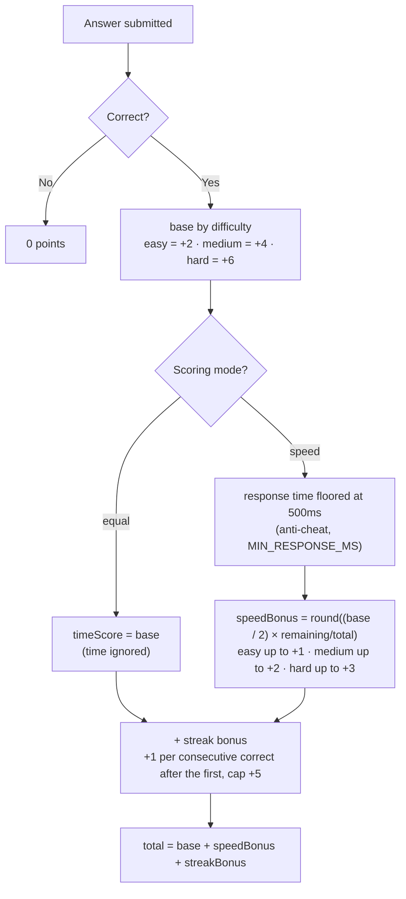
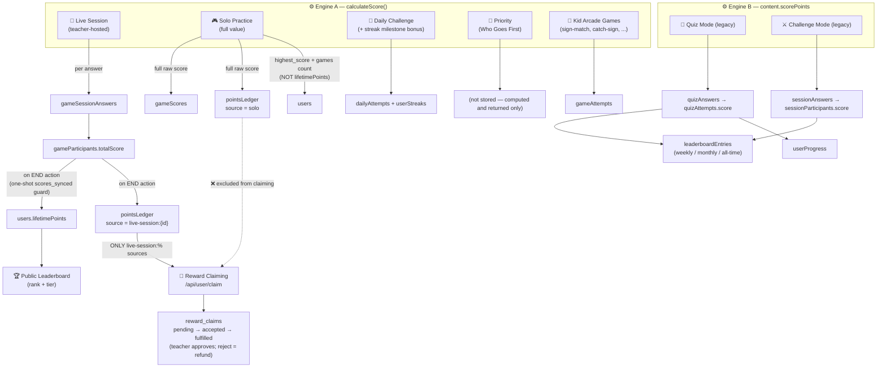
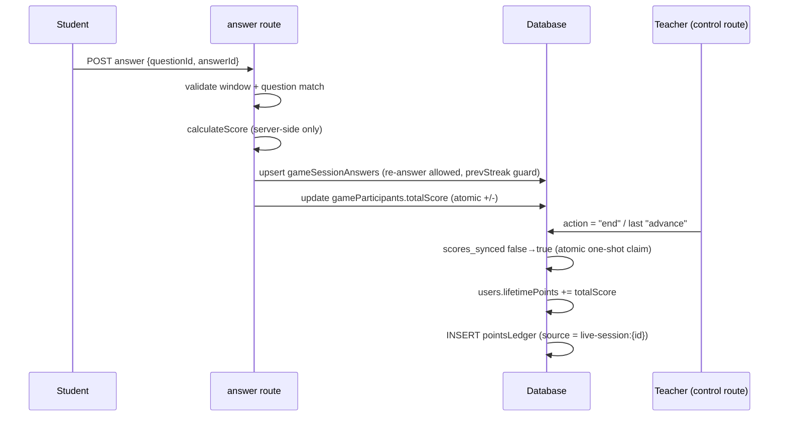

# Kesararam With Digital (KWD)

Kesararam With Digital (KWD) is a modern, high-performance web application built on Next.js 15, designed to gamify road safety education for students, teachers, and driving academies in Cambodia.

---

## 🛠️ Technology Stack

* **Frontend**: Next.js 15 (App Router), React 19, Tailwind CSS v4, GSAP, Radix UI (Base UI)
* **Backend & Database**: Next.js Server Actions, Drizzle ORM, Neon PostgreSQL (Serverless)
* **Authentication**: Stateless Jose JWT cookies with role-based routing and custom 2FA (TOTP)
* **Hosting & Media**: Cloudinary (media upload), Stripe (subscriptions)
* **Testing**: Vitest for unit and integration testing

---

## 👥 User Roles & Permissions

The platform supports four user roles defined in `src/db/schema/users.ts`:

| Role | Pricing | Access Level | Description |
| :--- | :--- | :--- | :--- |
| **`student`** | Free | Learner portal | Plays quizzes, tracks scores, views streaks, and competes on class leaderboards. |
| **`teacher`** | Paid (Plans) | Teacher dashboard | Creates classrooms, generates invite codes, monitors student performance, and manages assignments. |
| **`staff`** | System | Moderation dashboard | Creates and moderates quiz content, lessons, and reviews submissions. Requires 2FA. |
| **`admin`** | System | Control center | Manages users, activates subscriptions, overrides database settings, and views system logs. Requires 2FA. |

---

## 🔄 User Registration & Onboarding Flow

```
   ┌─────────────────────────────────────────────────────────────┐
   │                  Registration Gateway                       │
   └──────────────────────────────┬──────────────────────────────┘
                                  │
                  ┌───────────────┴───────────────┐
                  ▼                               ▼
            [ STUDENT ]                      [ TEACHER ]
                  │                               │
        ┌─────────┴─────────┐            ┌────────┴─────────┐
        ▼                   ▼            ▼                  ▼
    [ Google ]           [ Email ]   [ Direct Web ]    [ Offline App ]
        │                   │            │                  │
        └─────────┬─────────┘            │          (KHQR / Telegram)
                  ▼                      ▼                  ▼
       Account Created (student)   7-Day Trial        Admin Activated
                  │                      │                  │
                  ▼                      ▼                  ▼
        [/profile/student] Gate   Teacher Dashboard   Teacher Dashboard
                  │
          (Invite Code Check)
                  │
        ┌─────────┴─────────┐
        ▼                   ▼
     (No Class)         (Enrolled)
        │                   │
        ▼                   ▼
    CompleteProfile     Profile Dashboard
```

### 1. Student Onboarding & Verification Gate
* **Registration**: Students sign up using Google Sign-In (recommended) or email. They are immediately redirected to `/profile/student`.
* **Profile Completeness Check**: A Next.js server check validates if `schoolName`, `province`, or `gradeLevel` are null, and if the student is actively enrolled in a class.
* **The Invite Code Gate**:
  * Students must provide a valid **Teacher Invite Code** to unlock their account.
  * Entering a code queries `/api/invite/lookup` which automatically resolves the classroom's school, province, grade, and section details.
  * Students customize their character avatar (`face` and `head` assets), choose a display name, and submit.
* **Single-Class Enrollment**: The system enforces that a student belongs to only one class at a time. Saving profile details deletes previous active enrollments and inserts the new enrollment record.
* **Profile Cooldowns**: Once onboarding is complete, school and grade details are locked. A **60-day profile cooldown** restricts further modifications, and username changes are capped at once every **365 days** to prevent account sharing.

### 2. Teacher Onboarding & Billing
* **Direct Web Signup**: Teachers register directly and select a subscription tier (*Teacher Pro*, *Family*, or *Driving School*). The system automatically provisions a **7-day free trial** (`status: "trial"`) for immediate sandbox access.
* **Offline Applications**: For school boards or academies, users submit applications via `/register/teacher`. These go to a `pending` queue. The teacher pays via KHQR, sends the receipt to the admin via Telegram, and an administrator manually provisions the account.
* **Profile Cooldowns**: Post-onboarding, teachers are subject to a **60-day profile cooldown** on sensitive changes (e.g., username, email, display name).

### 3. Staff & Admin Authentication
* Direct registration is disabled for administrators and staff. Accounts are provisioned or elevated manually.
* Logins for administrative users are protected by **TOTP (2FA)**. After verification of credentials, users are required to supply a 6-digit TOTP code or recovery code.
* On login:
  * **Admin** redirects to `https://dashboard.kesararamwithdigital.tech/admin/users`
  * **Staff** redirects to `https://dashboard.kesararamwithdigital.tech/staff/content`

---

## 🗄️ Database Architecture

The core relational structure is defined using Drizzle ORM:

* **`users`**: Stores authentication records, TOTP parameters, school profile data, public privacy flags, and lifetime statistics.
* **`classes`**: Tracks classrooms, grade levels, locations, status (`active`, `locked`, `archived`), and unique entry codes.
* **`class_enrollments`**: Relational bridge mapping students to their unique current classroom.
* **`invite_codes`**: Single-use invites generated by teachers mapping a classroom to an onboarding student.
* **`subscriptions`**: Manages paid access contracts, billing status, trials, and active periods for teachers.

---

## 🎯 Score & Points System

This section documents the **actual current implementation** of how every game type calculates, records, and stores points.

### The Two Scoring Engines

The platform currently runs **two independent scoring engines** (unification is planned — see Roadmap below):

| Engine | Function | Used by | Location |
| :--- | :--- | :--- | :--- |
| **Engine A** (modern) | `calculateScore()` | Live sessions, Solo, Daily, Priority, Kid games | `src/lib/game-engine.ts` |
| **Engine B** (legacy) | `content.scorePoints` + time bonus | Quiz mode, Challenge mode | `src/app/api/quiz/answer`, `src/app/api/challenge/answer` |

### Engine A — `calculateScore()` Algorithm (Simple Live Scale, June 2026)



### Engine B — Legacy Algorithm (Quiz / Challenge)

```
points = content.scorePoints                                  (per-question value stored in DB)
IF timeSpent < timeLimit:
    timeBonus = floor(scorePoints × (1 − timeSpent/timeLimit) × 0.5)   → up to +50%
total = points + timeBonus
```

### Master Flow — Where Every Game's Points Go



### Per-Game Reference Table

| Game | Engine | Endpoint | Score stored in | Leaderboard | Claimable |
| :--- | :--- | :--- | :--- | :---: | :---: |
| **Live session** | A | `POST /api/game/sessions/[code]/answer` → `control (end)` | `gameSessionAnswers` → `gameParticipants` → `users.lifetimePoints` + `pointsLedger` | ✅ | ✅ **(only source)** |
| **Solo practice** | A (full value) | `POST /api/game/solo/complete` | `gameScores` (raw) + `pointsLedger` (source = solo); updates `highestScore` + games count — **NOT** `lifetimePoints` | solo board only | ❌ |
| **Daily challenge** | A + streak bonus | `POST /api/game/daily/complete` | `dailyAttempts` + `userStreaks` | ❌ | ❌ |
| **Priority (Who Goes First)** | A | `POST /api/game/priority/complete` | *(nothing — computed only)* | ❌ | ❌ |
| **Kid arcade games** | A *(trusts client correctness)* | `POST /api/game/[gameId]/complete` | `gameAttempts` | ❌ | ❌ |
| **Quiz mode** (legacy) | B | `POST /api/quiz/answer` + `complete` | `quizAnswers` → `quizAttempts` + `userProgress` + `leaderboardEntries` | legacy boards | ❌ |
| **Challenge mode** (legacy) | B | `POST /api/challenge/answer` + `complete` | `sessionAnswers` → `sessionParticipants` + `leaderboardEntries` | legacy boards | ❌ |
| **Guests** (any game) | — | same routes | *(never persisted)* | ❌ | ❌ |

### Live Session Lifecycle (the only claimable path)



### Reward Claiming + Fulfillment Workflow

```
claimable = SUM(pointsLedger.points WHERE source LIKE 'live-session:%')
          − SUM(reward_claims.cost WHERE status <> 'rejected')   (pending/accepted/fulfilled hold the cost)

claim succeeds when: claimable ≥ item cost   (validated against src/lib/rewards.ts catalog)
```

A claim is a `reward_claims` row routed to the student's class teacher:

```
pending  ──teacher accepts──▶  accepted (preparing)  ──teacher marks given──▶  fulfilled
   └────────────────── teacher rejects ──────────────────▶  rejected (cost refunded)
```

APIs: `POST /api/user/claim` (create + balance) · `GET /api/user/claim` (my claims) ·
`GET /api/teacher/claims` · `PATCH /api/teacher/claims/[id]` (accept | reject | fulfill).
Teacher UI: `/teacher/claims`. Accounting source of truth: `src/lib/claims.ts`.

### Management Guide — One Place to Tune Each Thing

| To change... | Edit |
| :--- | :--- |
| Base points by difficulty | `DIFFICULTY_BASE` (2 / 4 / 6) in `src/lib/game-engine.ts` |
| Streak bonus step / cap / anti-cheat floor | `STREAK_BONUS_STEP` · `STREAK_BONUS_MAX` · `MIN_RESPONSE_MS` in `src/lib/game-engine.ts` |
| Solo score value | full raw score, no multiplier (`SOLO_SCORE_MULTIPLIER` removed); writes `pointsLedger (source = solo)` only |
| Daily play limits per tier | `PLAY_LIMITS` in `src/lib/game-engine.ts` |
| Reward catalog & prices | `REWARD_ITEMS` in `src/lib/rewards.ts` (claim API + UI share it) |
| Rank tier thresholds | `RANK_TIERS` in `src/lib/rank-utils.ts` |
| What counts as claimable / claim accounting | `LIKE 'live-session:%'` filter + `src/lib/claims.ts` |

### ⚠️ Known Weak Spots

1. **Two engines** — legacy Quiz/Challenge write to a separate `leaderboardEntries` board disconnected from `users.lifetimePoints`. Same student effort earns incompatible currencies.
2. **Kid games trust the client** — `recordGameAttempt` accepts `isCorrectGuess` from the browser (practice-only, low stakes, but should be server-validated like `validatePriority`).
3. **Priority game stores nothing** — player results are computed and discarded.
4. **Daily streak milestone bonus is intentionally small** — `streakMilestoneBonus` returns +2/+5/+15 for 3/7/30-day milestones. Only affects the daily practice score (not Store Points).

### 🗺️ Roadmap — Engine Unification Plan

Goal: **one algorithm (`calculateScore`), one ledger (`pointsLedger`), one leaderboard (`users.lifetimePoints`)** for every game.

| Phase | Work | Risk |
| :--- | :--- | :--- |
| **1. Freeze Engine B** | Stop tuning `content.scorePoints`; treat quiz/challenge scoring as read-only | none |
| **2. Route quiz mode through Engine A** | `quiz/answer` maps `content` → difficulty and calls `calculateScore()`; write `pointsLedger (source = quiz)`; keep old columns for history | low |
| **3. Route challenge mode through Engine A** | Same swap in `challenge/answer`; decide whether challenge counts as "live" (claimable) or practice | medium |
| **4. Migrate legacy boards** | Backfill `leaderboardEntries` totals into `pointsLedger` rows (`source = legacy-migration`), then read all boards from the ledger | medium |
| **5. Server-validate kid games** | Send answer keys server-side; stop trusting `isCorrectGuess` | low |
| **6. Persist priority game** | Write `gameAttempts` rows (or supersede with the planned Traffic Commander redesign) | low |
| **7. Retire Engine B** | Remove time-bonus code from quiz/challenge routes; `leaderboardEntries` becomes a derived view | low |

Each phase is independently deployable; sources in `pointsLedger` make every phase auditable and reversible.

---

## 💻 Development & Operations

### Installation
```bash
# Install dependencies
pnpm install
```

### Running Locally
```bash
# Start development server
npm run dev

# Build for production
npm run build

# Start production server
npm run start
```

### Database Management
```bash
# Apply migrations
npm run db:migrate
npm run db:migrate-stripe
npm run db:migrate-2fa
npm run db:migrate-gamekit
npm run db:migrate-scores-synced

# Verify migration consistency
npm run db:verify

# Launch Drizzle Studio
npm run studio
```

### Testing & Audits
```bash
# Run unit and integration tests
npm run test

# Perform security audit and check codebase for secrets
npm run security:full
```

---

## 🔒 Security Policies

For details regarding vulnerability reporting and security configurations, please refer to [SECURITY.md](SECURITY.md).
